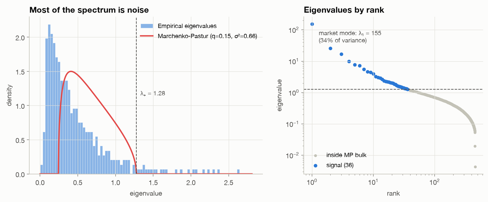
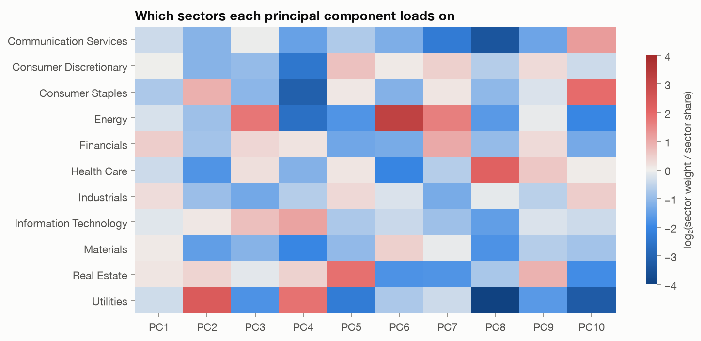
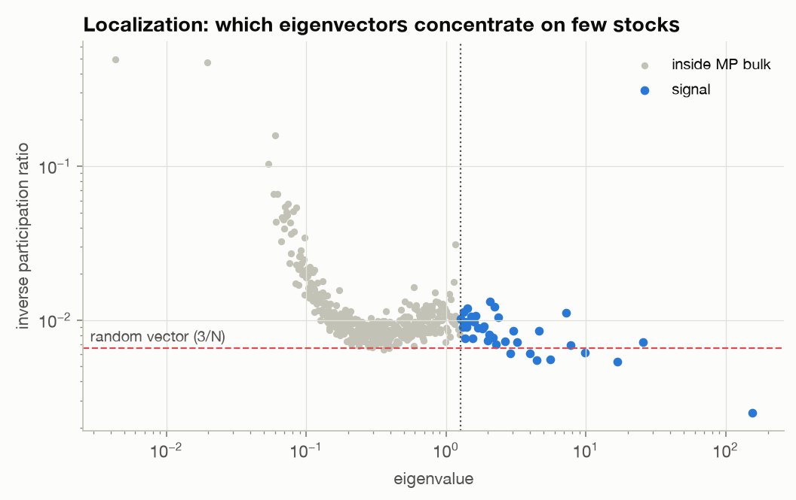
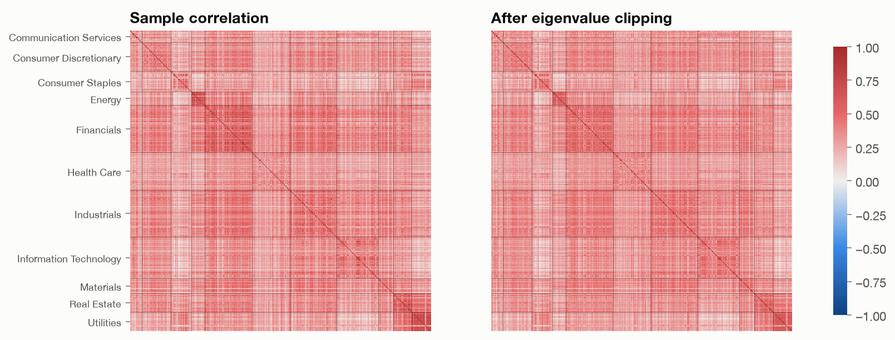
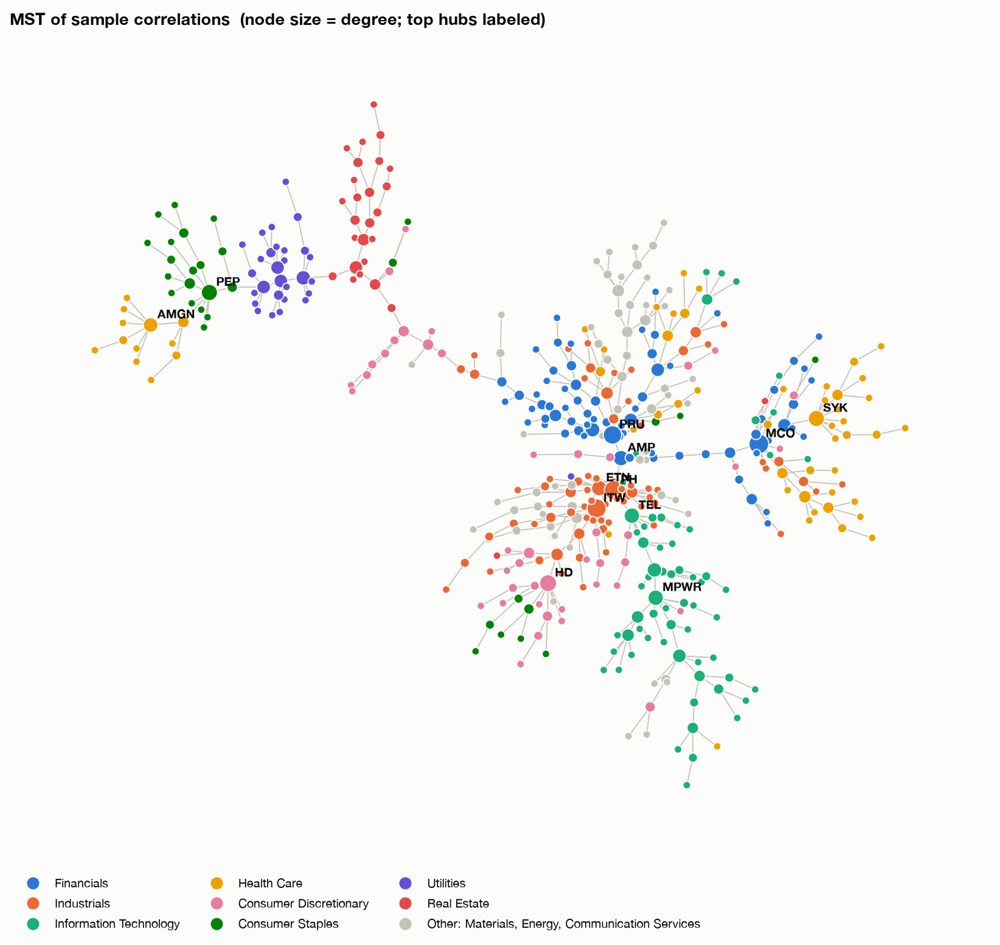
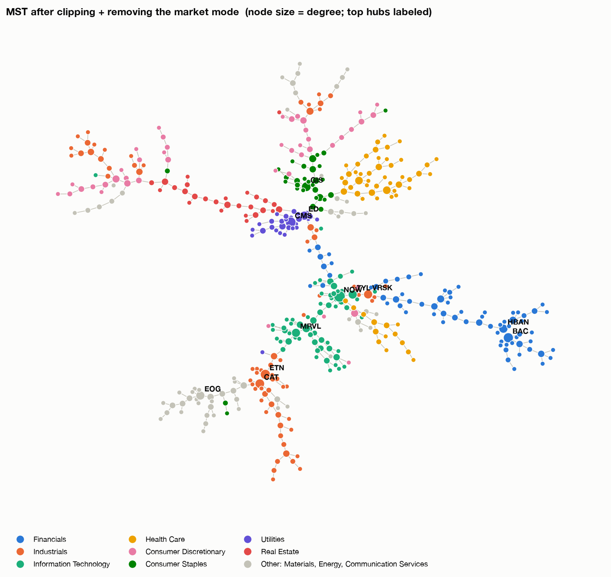
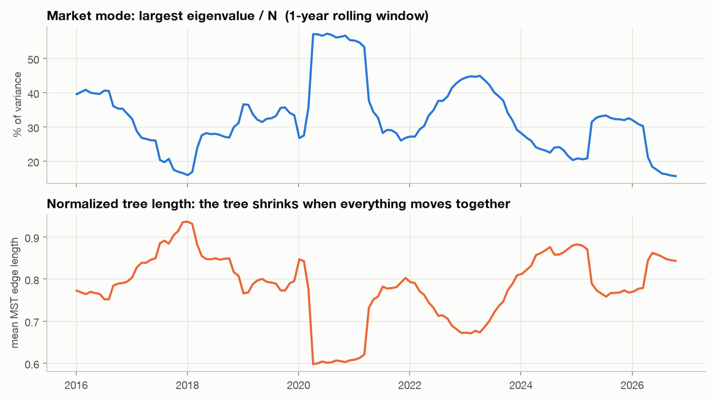
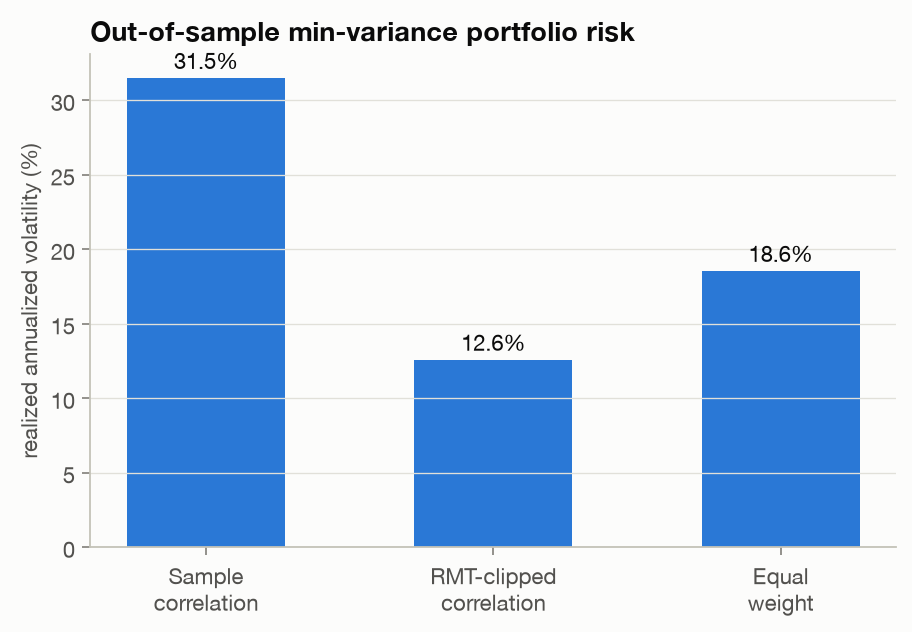

# S&P 500 correlation structure: RMT, PCA and minimum spanning trees

A small linear algebra / statistics playground. Take daily returns of every
S&P 500 stock, build the 450×450 correlation matrix, and ask:

1. **How much of it is noise?** Compare the eigenvalue spectrum to the
   Marchenko-Pastur law and *clip* the eigenvalues that are indistinguishable
   from noise.
2. **What do the principal components mean?** Market mode, sector modes,
   localization (inverse participation ratio).
3. **What does the network look like?** Minimum spanning tree on the
   correlation distance, before and after removing the market mode.
4. **Does any of this matter?** Out-of-sample minimum-variance portfolios built
   from the raw vs. cleaned correlation matrix.

> **📖 Article: [What the principal components of the S&P 500 actually mean](docs/what-the-pcs-mean.md)**
> covers reading eigenvectors, linking PCs to macro/style factors, why deep
> PCs are unstable mixtures, and how a varimax rotation recovers clean
> sector factors.

## Run it

Requires [uv](https://docs.astral.sh/uv/).

```bash
uv run sp500-corr                       # 2015-01-01 to today
uv run sp500-corr --start 2005-01-01 --end 2012-12-31
uv run sp500-corr --refresh             # ignore the cached download
uv run sp500-article                    # analysis + figures for the article
uv run pytest
```

The first run downloads the constituent list from Wikipedia and prices from
Yahoo Finance (via `yfinance`) into `data/` (git-ignored). Figures and a
`summary.json` go to `figures/`.

## The math in one screen

**Returns → correlation.** Log returns $r_{ti}$, standardized per stock, give
$C = \frac{1}{T} Z^\top Z$ with $N$ stocks and $T$ days. Only stocks with
(near-)complete history are kept so $C$ is computed on a common set of dates
and stays positive semi-definite.

**Marchenko-Pastur.** If the $N$ series were independent with variance
$\sigma^2$, the eigenvalues of $C$ would still spread over

$$\lambda_\pm = \sigma^2\left(1 \pm \sqrt{q}\right)^2, \qquad q = N/T,$$

with density
$\rho(\lambda) = \frac{\sqrt{(\lambda_+ - \lambda)(\lambda - \lambda_-)}}{2\pi q \sigma^2 \lambda}$.
Following Laloux et al. (1999), the market mode is not noise, so the noise
variance is $\sigma^2 = 1 - \lambda_1 / N$.

**Clipping.** Keep eigenpairs with $\lambda_k > \lambda_+$; replace every
other eigenvalue with their mean (this preserves the trace), rebuild
$V \Lambda V^\top$ and rescale to a unit diagonal.

**Detoning.** Subtract $\lambda_1 v_1 v_1^\top$ to remove the market mode so
the sector structure stands out (good for trees and clustering; the result is
singular, so don't invert it).

**MST.** $d_{ij} = \sqrt{2(1 - \rho_{ij})}$ is a proper metric (it's the
Euclidean distance between standardized return vectors). The MST keeps the
$N-1$ shortest edges that connect all stocks (Mantegna, 1999).

## Results (2015-01 → 2026-11, 456 stocks × 2,980 days)

| | |
|---|---|
| $q = N/T$ | 0.15 |
| Noise variance $\sigma^2$ | 0.66 |
| MP upper edge $\lambda_+$ | 1.28 |
| Eigenvalues above $\lambda_+$ | **36 of 456** |
| Variance explained by those 36 | 64% |
| Market mode $\lambda_1$ | 155 (34% of all variance) |
| corr(PC1 portfolio, equal-weight index) | 0.997 |
| MST edges within one GICS sector | 83% raw, **90% detoned** (shuffled null: 11%) |
| Out-of-sample GMV volatility | sample **31.5%**, clipped **12.6%**, equal weight 18.6% |

### The spectrum


One huge eigenvalue (the market), a handful of sector eigenvalues, then a bulk.
The bulk does *not* match MP perfectly: it sits to the left and has a long
tail toward zero. Real returns are fat-tailed and their volatility changes over
time, which MP doesn't account for. The two smallest eigenvalues (0.004 and
0.02) are share classes: their eigenvectors are exactly $(+0.71, -0.71)$ on
GOOG/GOOGL and NWS/NWSA. Two classes of one company are almost perfectly
correlated, so $C$ is almost singular along their difference.

### What the components load on


Each cell is log₂(share of the PC's squared loadings in a sector ÷ the
sector's share of stocks). PC1 is flat (the market). The next ones are
recognizable sector bets: Utilities (PC2), Energy (PC3, PC6), Real Estate (PC5),
Health Care (PC8), Consumer Staples (PC10).



The inverse participation ratio $\sum_i v_{ik}^4$ is about $1/N$ for the market
mode (every stock participates), about $3/N$ for random vectors, and spikes to
about 0.5 for the smallest eigenvalues, which each sit on a single share-class pair.

### Cleaning


### Minimum spanning trees


The raw MST already clusters by sector, but it is organized around the market:
diversified Financials and Industrials (MCO, PRU, ITW, PH) are the hubs.



After clipping and removing the market mode, the tree splits into clean sector
branches: Energy pulls away from Industrials, Utilities form a tight star
around CMS/ED, and banks (BAC, HBAN) form their own subtree.

### Through time


Rolling one-year windows. In March 2020 the market mode jumps to almost 60% of
variance, and the normalized tree length collapses to its minimum (0.60 on
2020-04-06): in a crash, everything moves together and the tree contracts
(Onnela et al., 2003).

### Does cleaning matter?


Every month we estimate the covariance from the previous two years
($T = 504$, so $q \approx 0.9$) and hold the global minimum-variance portfolio
$w \propto \Sigma^{-1}\mathbf{1}$ for 21 days. Inverting the raw matrix blows
up its noisy small eigenvalues, and the "minimum variance" portfolio ends up
*more* volatile than equal weight. Clipping cuts realized vol by 60%.

## Caveats

- **Survivorship bias:** the universe is *today's* constituents. That's fine
  for correlation structure, but don't read the returns as an index backtest.
- Stocks without near-full history over the window (recent IPOs, spin-offs)
  are dropped.
- Yahoo data is good for playing around, not for production.

## Project layout

```
src/sp500_corr/
  data.py       constituents (Wikipedia) + prices (yfinance), cached
  rmt.py        Marchenko-Pastur, noise-variance fit, clipping, detoning
  pca.py        IPR, sector enrichment, eigenportfolios
  interpret.py  top loadings, factor correlations, R², stability, varimax
  article.py    the analysis behind docs/what-the-pcs-mean.md (`uv run sp500-article`)
  mst.py        distance, MST, sector purity test, rolling tree length
  portfolio.py  rolling out-of-sample GMV backtest
  plots.py      all figures
  cli.py        the pipeline (`uv run sp500-corr`)
tests/          synthetic checks: pure noise stays in the MP bulk,
                planted factors are found, MST is a tree, etc.
```

## Ideas to extend

- Other cleaners: Ledoit-Wolf shrinkage, rotationally invariant estimators
  (Bun, Bouchaud & Potters, 2016), and how they compare with clipping in the GMV test.
- Hierarchical clustering / HRP on the cleaned matrix.
- Planar maximally filtered graph (PMFG) instead of the MST.
- Rolling sector purity: do sectors dissolve in crises?

## References

- Laloux, Cizeau, Bouchaud, Potters (1999). *Noise dressing of financial correlation matrices.* PRL 83.
- Plerou et al. (2002). *Random matrix approach to cross correlations in financial data.* PRE 65.
- Mantegna (1999). *Hierarchical structure in financial markets.* EPJ B 11.
- Onnela, Chakraborti, Kaski, Kertész (2003). *Dynamic asset trees and Black Monday.* Physica A 324.
- Bun, Bouchaud, Potters (2017). *Cleaning large correlation matrices: tools from RMT.* Physics Reports 666.
