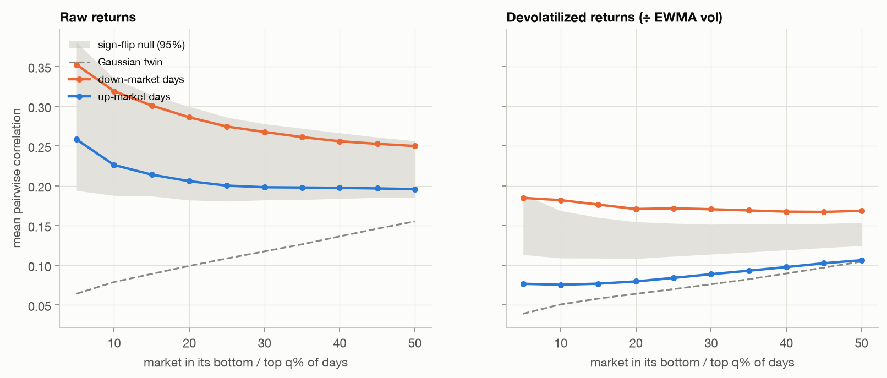
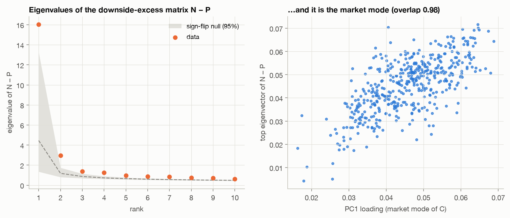
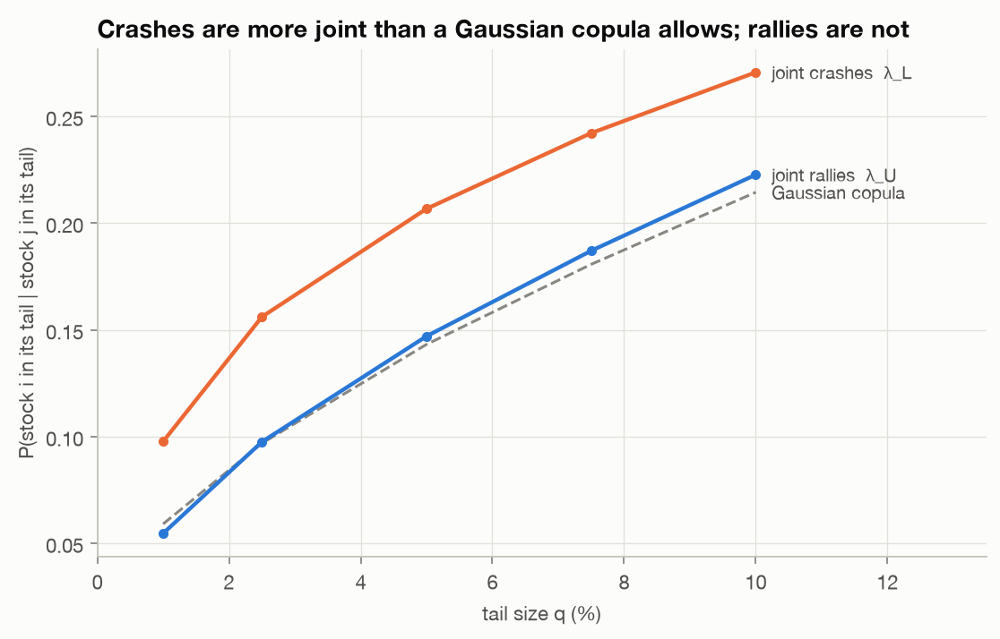
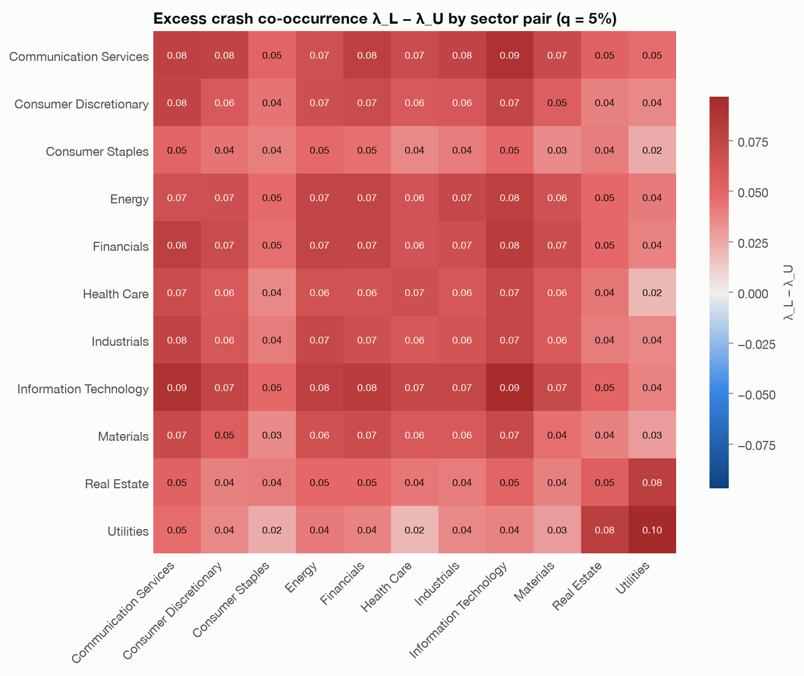
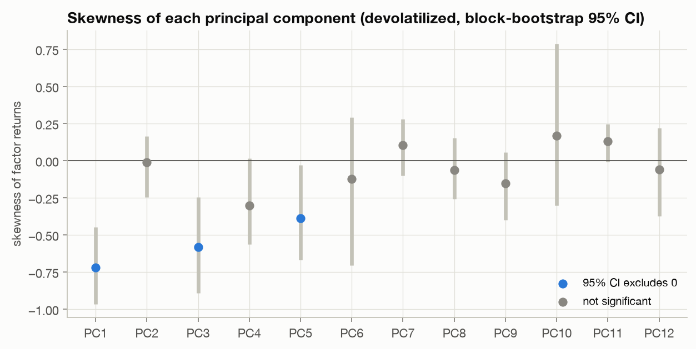
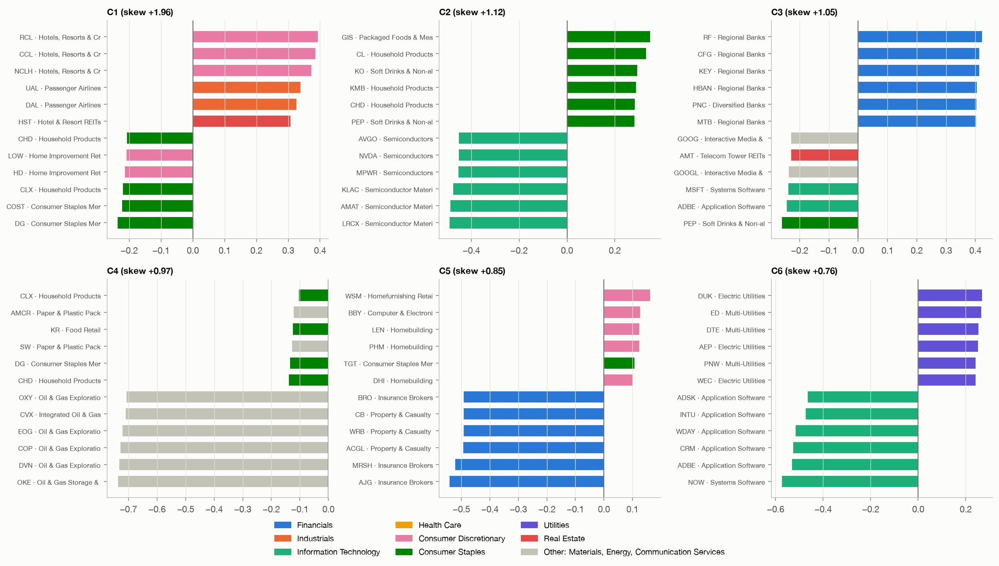
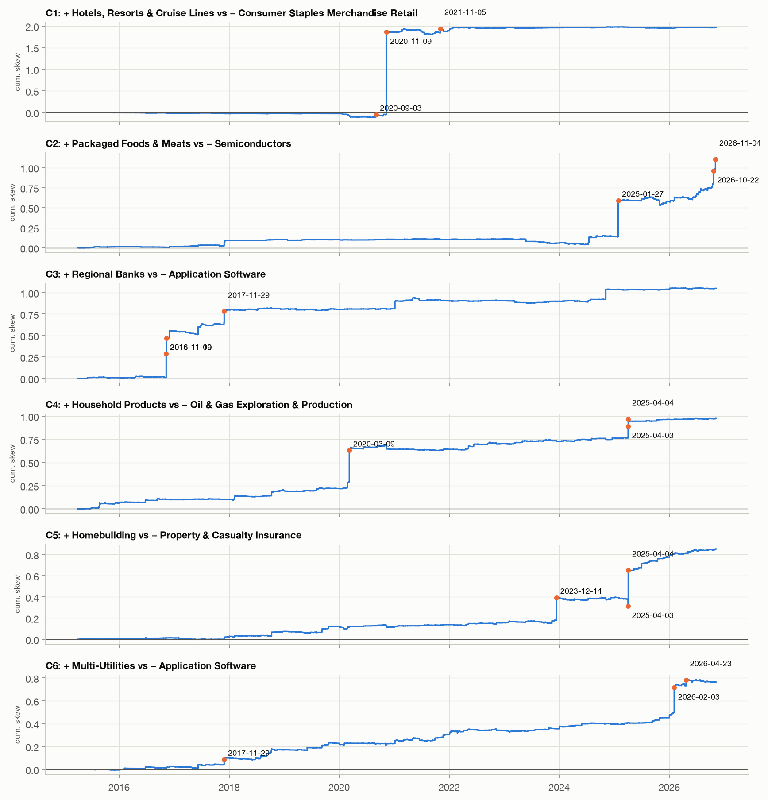

# Do stocks fall together? Leaving the quadratic world

*Part II of the S&P 500 correlation project. [Part I](what-the-pcs-mean.md)
interpreted the principal components of the correlation matrix; here we
ask what correlation can't see.*

---

**TL;DR**

- A correlation matrix can't tell crashes from rallies: flip the sign of
  every return and it doesn't change. We test for asymmetry with a null model
  that keeps everything *except* direction: **flip the sign of whole days at
  random**.
- On raw returns, **nothing is significant**. The crash days are too few and too
  loud. After dividing each return by its own recent volatility, the
  asymmetry is unmistakable:
  - Mean correlation is **0.17 on down-market days vs 0.08 on up-market days**
    (z = 4.7), and the spanning tree is significantly shorter on the way down.
  - In the semicovariance split, joint down-moves contribute more than joint
    up-moves, and the excess lies almost entirely along the **market mode**
    (overlap 0.98). A second, weaker excess lines up with PC2 (defensives vs. tech).
  - **Joint rallies look like a Gaussian copula** (λ_U = 0.147 vs 0.143
    at the 5% tail); **joint crashes don't** (λ_L = 0.207, z = 4.3).
- Going to the third moment, the **coskewness tensor** can in principle
  identify factors that correlation leaves ambiguous. On real data it
  identifies **events**: the vaccine day, two elections, DeepSeek, the 2025
  tariffs. One "factor" gets 97% of its skewness from a single day.

---

## 0. Why correlation is blind to direction

Everything in Part I came from $C = \frac1T \sum_t z_t z_t^\top$. Replace every
return $z_t$ with $-z_t$ and each term $z_t z_t^\top$ stays the same. A world
where stocks crash together and rally independently can have exactly the
same $C$ as its mirror image. Any statistic that can see asymmetry must
**change sign (or swap roles) when $z_t \to -z_t$**: odd moments,
conditional statistics, tails.

### The null model: random sign flips

To test such a statistic, we need data that is identical to ours in every
respect except direction. Multiply *all* returns on day $t$ by the same
random $s_t = \pm 1$:

- the correlation matrix is unchanged (every $z_t z_t^\top$ is unchanged);
- each stock's fat tails, and the market's volatility clustering, are unchanged;
- but "down" and "up" are now exchangeable.

Repeat a few hundred times, and the spread of a statistic across flips is
its sampling noise under perfect symmetry. Every z-score below is measured
against this null.

### The preprocessing step that makes everything work

Crashes cluster in time: the worst days of the sample are mostly March
2020. On raw returns, a few such days dominate any down-vs-up comparison,
and the null band becomes so wide that nothing is significant. We therefore
also run everything on **devolatilized returns**: each return divided by its
own EWMA volatility estimate (RiskMetrics, λ = 0.94), computed **from past
data only**. This asks a cleaner question: *relative to how volatile things
already were*, do stocks fall together more than they rise together?

## 1. Down-market vs. up-market correlation

Sort days by the equal-weight market return. Compute the correlation matrix
using only the worst $q$% of days, then only the best $q$%.



**Left (raw returns):** down-market correlations *are* higher (0.29 vs 0.21
at q = 20%), but the grey sign-flip band covers them: z = 1.2. The way the
crash days happen to fall into the down set could produce that gap.

**Right (devolatilized):** the down curve is above the band and the up curve
below it, at every threshold. At q = 20%:

| | down days | up days | z vs. null |
|---|---|---|---|
| mean pairwise correlation | 0.171 | 0.080 | **4.7** |
| market mode λ₁ / N | 18.4% | 9.2% | **4.6** |
| normalized MST length | 0.913 | 0.981 | **−4.8** |
| 2nd eigenvalue λ₂ | 36.6 | 34.0 | 1.0 |
| eigenvalues above MP edge | 20 | 18 | 1.8 |

On down days the market mode doubles and the tree contracts. The second
eigenvalue (the sector structure) does not change significantly. **Falling
together is a market-mode phenomenon.**

### A trap worth knowing: conditioning changes correlation even with no asymmetry

The dashed line is a **Gaussian twin**: multivariate normal data with the
same correlation matrix. Look at what conditioning does to it: the unconditional
mean correlation is 0.33, but on the twin's bottom-20% or top-20% market days
it's about 0.1. Selecting days by the market's *level* truncates the market
factor, and correlations collapse. (The more famous version of this
trap, from Forbes & Rigobon (2002), goes the other way: selecting *high-volatility*
periods inflates correlation.) Either way, **"correlation is X in crashes"
means nothing without a benchmark** that went through the same conditioning.
The sign-flip null is that benchmark.

## 2. Semicovariance: splitting C by direction

Split each return into its positive and negative parts, $z = z^+ + z^-$.
Then $C$ splits *exactly* into three matrices (Bollerslev, Li, Patton &
Quaedvlieg, 2020):

$$C = \underbrace{\tfrac1T\textstyle\sum z^+ z^{+\top}}_{P:\ \text{both up}}
 + \underbrace{\tfrac1T\textstyle\sum z^- z^{-\top}}_{N:\ \text{both down}}
 + \underbrace{\tfrac1T\textstyle\sum (z^+ z^{-\top} + z^- z^{+\top})}_{M:\ \text{mixed}}$$

A sign flip swaps a day's contribution between $P$ and $N$, so under
symmetry $E[N] = E[P]$. The **downside-excess matrix** $A = N - P$ is a
symmetric matrix that is zero in expectation under the null, so we can analyze it with the
same eigen-tools as $C$.

(Devolatilized:) average off-diagonal entries are $P = 0.187$, $N = 0.220$,
$M = -0.153$. Joint down-moves generate 18% more co-movement than joint
up-moves (z = 2.5).



The spectrum of $A$ has **one dominant eigenvalue** (16.0, against a null of
5.5 ± 3.2), and its eigenvector is **the market mode** (overlap 0.98 with
PC1, right panel). Section 1 found the same thing by a completely
different route.

A **second** eigenvalue (2.95) also clears the null (97.5th percentile 1.74).
Its eigenvector has overlap 0.91 with **PC2** from Part I, utilities and REITs
vs. tech. The defensive block and the tech block each fall together more
than they rise together, beyond what the market mode explains. We'll see
the same two sectors again in the next section.

## 3. Tail dependence: asymmetry without assuming normality

Correlation and semicovariance are still averages of products, so a few
huge returns can dominate them. **Copula** methods discard the size of
returns entirely: convert each stock's returns to ranks $u \in (0,1)$ and
ask only about joint *ranks*:

$$\lambda_L(q) = P(u_i \le q \mid u_j \le q), \qquad
  \lambda_U(q) = P(u_i \ge 1-q \mid u_j \ge 1-q).$$

"Given that stock $j$ had one of its worst 5% of days, how likely is stock $i$
to be having one of its worst 5% too?" The benchmark is a **Gaussian copula**
fitted to the same rank correlations. It's symmetric by construction, and has
*no* tail dependence in the limit.



The picture is striking. **The upper tail sits on the Gaussian line** (at 5%:
λ_U = 0.147 vs 0.143), so rallies co-occur exactly as often as a Gaussian
predicts. **The lower tail doesn't** (λ_L = 0.207), at every threshold from 1%
to 10% (z = 2.3 to 5.2 against the sign-flip null). The asymmetry is entirely
a property of the downside.



Every sector pair has λ_L > λ_U: there's no blue anywhere in the heatmap.
The largest within-sector excesses are **Utilities (0.097) and IT
(0.094)**, the two blocks of the second semicovariance eigenvector. The
smallest are Consumer Staples (0.040) and Materials (0.045). By stock, the
most crash-coupled names are **META, MSFT, AMZN, APH, KKR, GOOGL, GPN, BX,
TEL, NVDA**: megacap tech, electronic components and alternative asset
managers. The least crash-coupled are grocers, food and household staples
(KR, SJM, MKC, CLX), plus a utility (ES), an insurer (ERIE) and DaVita (DVA).

## 4. The heavy version: the coskewness tensor

### Why go to third moments?

Part I left a puzzle. Second moments determine the signal *subspace*, but
**not the axes inside it**: if $x = A s$ with uncorrelated unit-variance
factors $s$, then $A R$ for *any* rotation $R$ fits the covariance equally
well. Varimax picked axes by a heuristic (sparsity).

Third moments break that tie. If the factors are **independent and skewed**,
the coskewness tensor of whitened returns is

$$S_{abc} = E[f_a f_b f_c] = \sum_r \kappa_r\, a_{ar} a_{br} a_{cr},$$

a sum of rank-one terms whose directions $a_r$ are **unique** (Comon, 1994).
This is the identification theorem behind independent component
analysis. So in principle, the coskewness tensor can recover the rotation
that correlation can't.

### Making it computable

For 456 stocks the full tensor has $456^3 \approx 95$ million entries, most of them
noise. So we first **whiten** onto the top 12 PCs (the same signal subspace
as Part I), $f_t = \Lambda^{-1/2} V^\top z_t$, giving a 12 × 12 × 12 tensor.

### Warm-up: the skewness of each PC



On devolatilized returns, three components are significantly negatively skewed
(moving-block bootstrap, 20-day blocks): **PC1, the market (−0.72)**, PC3,
growth vs. value (−0.58), and PC5 (−0.39). The equal-weight index has skew
−0.73 [−1.00, −0.45]. On raw returns its CI is [−2.09, +0.36]: once again,
without devolatilizing you can't even show that the market is negatively skewed.

PC3's negative skew means its big moves are sudden lurches *toward value*:
banks and oil jumping while software drops in a single day. Hold that thought.

### Decomposing the tensor

We find the directions $u$ that locally maximize skewness, i.e. the
*Z-eigenvectors* of the tensor, satisfying $S(\cdot, u, u) = \kappa\, u$. We use the **tensor power
method** ($u \leftarrow S(\cdot,u,u) / \lVert S(\cdot,u,u) \rVert$, random
restarts, deflation; Anandkumar et al., 2014). The test suite checks that it
recovers four independent exponential factors hidden behind a random
rotation, a case where PCA sees nothing at all, since the data is already white.

On the real data, six components (sign chosen so that skew is positive,
i.e. the *+* side is the one that jumps up):



| | + side jumps vs. − side | skew [95% CI] | share from top 10 days | biggest days |
|---|---|---|---|---|
| C1 | cruise lines, airlines vs. discount & home-improvement retail | 1.96 [−0.16, 4.54] | 105% | **2020-11-09** (97% alone) |
| C2 | staples vs. semis | 1.12 [0.23, 1.89] | 83% | **2025-01-27**, 2026-10-22, 2026-11-04, 2024-07-17 |
| C3 | regional banks vs. megacap tech & software | 1.05 [0.33, 1.83] | 93% | **2016-11-09, 2016-11-10**, 2017-11-29, **2024-11-06** |
| C4 | the market and oil crashing together | 0.97 [0.41, 1.54] | 65% | **2020-03-09**, 2025-04-03, 2025-04-04 |
| C5 | homebuilders & home retail vs. insurers | 0.85 [0.34, 1.33] | 71% | 2025-04-04, **2023-12-14** |
| C6 | utilities vs. software | 0.76 [0.42, 1.14] | 64% | 2026-02-03, 2026-04-23, 2017-11-29 |

(C4 is −0.8 on PC1, so its loadings are dominated by the market with oil
producers most exposed. Its "+" direction is the market and oil *falling*.)



The cumulative-skewness chart above shows what's going on. **Skewness doesn't accumulate
smoothly; it arrives in steps**, and the steps are news days:

- **C1** is one day: **9 November 2020**, when Pfizer announced its vaccine
  results, cruise lines soared and stay-at-home staples fell. That single day
  is 97% of C1's skewness, and the bootstrap CI includes zero. It isn't a
  factor; it's an event.
- **C3** is the **election factor**: both US presidential election
  surprises (9–10 Nov 2016 and 6 Nov 2024) and a sharp rotation out of tech
  into banks on 29 Nov 2017 sent regional banks up and megacap tech down. This is PC3's
  negative skew from the warm-up, now with names and dates.
- **C2** jumps on **27 January 2025** (the DeepSeek sell-off in chip stocks),
  plus a few 2026 days we haven't attributed to specific news.
- **C4** is the **oil-and-market crash**: 9 March 2020 (oil price war +
  COVID) and the April 2025 tariff announcement.
- **C5** steps up on **14 December 2023**, the day after the Fed signaled
  rate cuts (homebuilders rallied), and on the April 2025 tariff days.

### So does the third moment identify the factors?

Yes and no:

- **It does pick out unique directions**, and they're meaningful: C2 lines
  up with the varimax semiconductor factor from Part I (overlap 0.90), C6 with
  utilities vs. software (0.72).
- **But what it identifies is "which stocks jumped together on the biggest
  news days".** Each component mostly shows up in the half of the sample that
  contains its event (C1: overlap 0.94 with the first-half decomposition but 0.34 with the second; C2:
  the reverse, 0.34 vs. 0.93). The identification theorem assumes
  independent, identically distributed factor shocks. Markets instead deliver
  a few enormous, one-off shocks, and third moments latch onto them.

So the third moment isn't a better PCA. It's an **event detector**: it
discovers, without being told any dates, that 9 Nov 2020 and 9 Nov 2016
were the defining days for two specific long-short trades.

## 5. What we learned

1. **Correlation can't see direction.** To test for asymmetry, use statistics
   that swap under $z \to -z$, and a null that keeps everything else: random
   sign flips of whole days.
2. **Devolatilize first.** On raw returns crashes are too few and too loud, and
   no asymmetry test is significant, including the market's own skewness.
3. **Stocks do fall together more than they rise together**, and the excess
   lies in the **market mode**: the down-day market eigenvalue is twice the
   up-day one, the tree contracts, and $N - P$ points along PC1.
4. **Rallies are Gaussian; crashes aren't.** Upper-tail co-occurrence
   matches a Gaussian copula almost exactly, while lower-tail co-occurrence
   is 45% higher than the Gaussian copula predicts (5% tail: 0.207 vs 0.143).
5. **Beyond the market, the asymmetry concentrates in defensives and
   tech** (second eigenvector of $N - P$ and the within-sector tail excess
   agree).
6. **Third moments identify directions, but the directions are events.** In
   principle the coskewness tensor fixes the rotation that correlation
   leaves free. In practice it finds the vaccine day, the elections, DeepSeek
   and the tariffs.

## Reproduce

```bash
uv run sp500-asymmetry      # figures/asymmetry/ + numbers.json (~1 min)
```

The code is in `src/sp500_corr/asymmetry.py`. Tests (`uv run pytest`) check
that the semicovariance decomposition is exact, that a sign flip swaps
$P \leftrightarrow N$ and $\lambda_L \leftrightarrow \lambda_U$, that
devolatilization uses only past data, and that the tensor power method
recovers independent skewed factors behind a random rotation.

*Caveats: current index members only; Yahoo Finance data; all
attributions of dates to news events are ours, made after the fact by
looking at the dates. The statistics found the dates; they don't know the reasons.*

## References

- Longin & Solnik (2001). *Extreme correlation of international equity markets.* J. Finance 56.
- Ang & Chen (2002). *Asymmetric correlations of equity portfolios.* JFE 63.
- Forbes & Rigobon (2002). *No contagion, only interdependence.* J. Finance 57.
- Bollerslev, Li, Patton & Quaedvlieg (2020). *Realized semicovariances.* Econometrica 88.
- Comon (1994). *Independent component analysis, a new concept?* Signal Processing 36.
- Anandkumar, Ge, Hsu, Kakade & Telgarsky (2014). *Tensor decompositions for learning latent variable models.* JMLR 15.
- RiskMetrics Technical Document (J.P. Morgan/Reuters, 1996).
