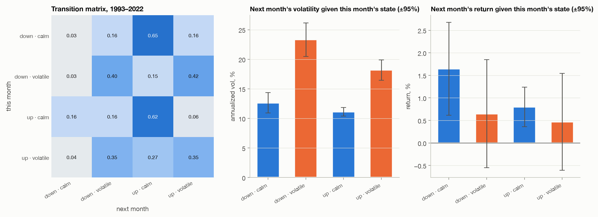
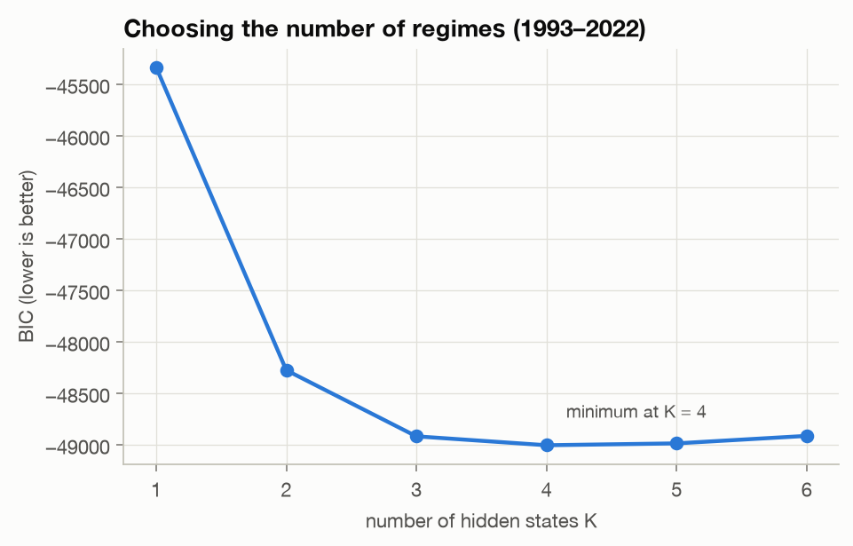
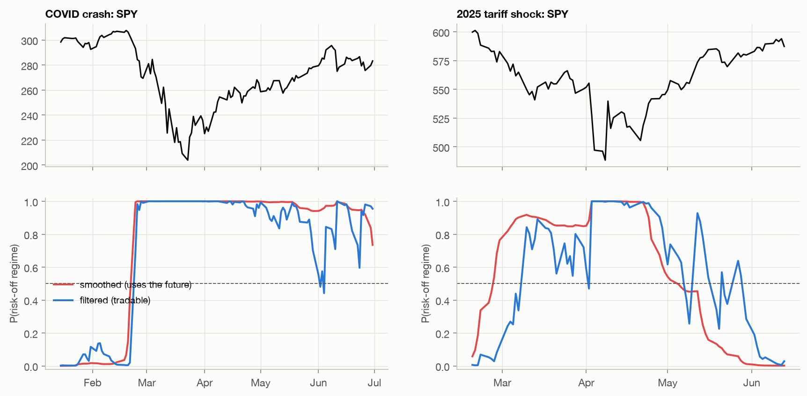
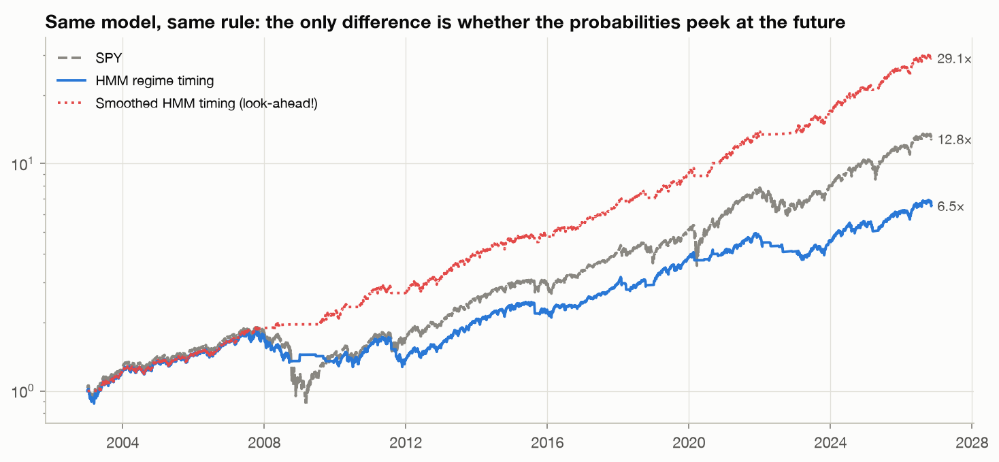
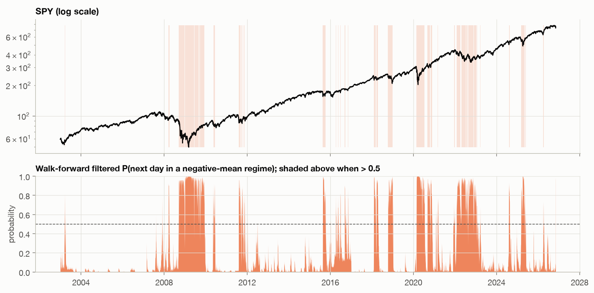
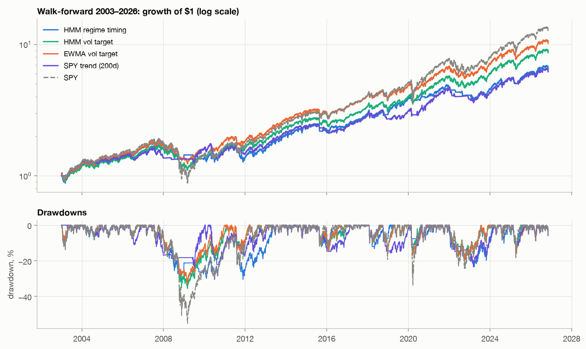
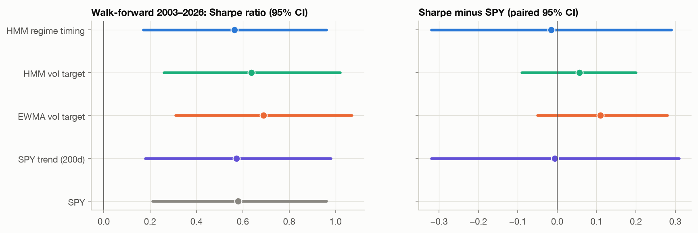
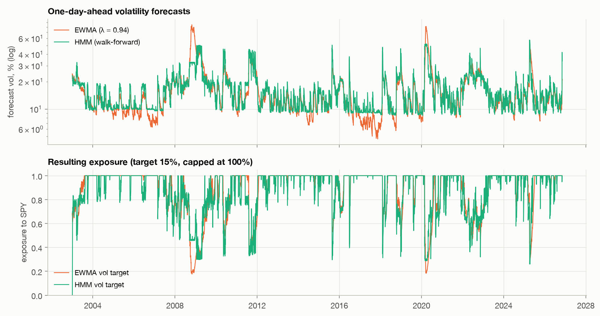

# Markov chains and regimes: what the market's "state" actually predicts

*Part IV of the S&P 500 correlation project. [Part III](portfolios.md) found
that risk is forecastable and returns mostly aren't. Regime models promise
more: identify the state the market is in, and position for the next one.
Here we test that promise with observable Markov chains, a hand-built hidden
Markov model, 24 years of walk-forward refits, and the same statistical
standards as before.*

---

**TL;DR**

- **A Markov chain on market states is a volatility forecaster, not a return
  forecaster.** Splitting monthly states into "volatile or calm" and "up or
  down": the volatility half is strongly Markov (p ≈ 10⁻²⁴), the direction half
  is not at all (p = 0.60). Next month's *volatility* differs enormously by state
  (p ≈ 10⁻²⁶); next month's *return* does not (p = 0.50).
- **The one return effect we found isn't tradable.** After a bad day, SPY's next
  day is better on average (z = 2.7, and bigger out of sample), but the rule
  trades ~107 times a year and breaks even at **2–5 bps per side**.
- **The look-ahead trap is enormous.** The same HMM and the same rule, with
  *smoothed* instead of *filtered* regime probabilities, doubles the Sharpe ratio
  (0.57 → 1.26) and turns a −24% max drawdown into −10%. The smoother doesn't see
  crashes earlier; it just never falls for false alarms (38 regime switches vs. 158).
- **Walk-forward 2003–2026, refit every year on past data only:** regime timing and
  volatility targeting cut 2008's loss from −46% to between −19% and −30%, but **no
  Sharpe ratio differs from SPY's**, and all of them earned less.
- **The HMM forecasts volatility slightly better than a one-line EWMA** (and
  significantly so in 2023–26), **yet as a portfolio it's no better**, and it trades
  2.5× more. Better forecasts don't automatically mean better portfolios.

---

## 0. What would a useful "state" look like?

A Markov chain says the future depends on the past only through the current
state $s_t$:

$$P(s_{t+1} = j \mid s_t = i, s_{t-1}, \dots) = P(s_{t+1} = j \mid s_t = i) = p_{ij}.$$

For a portfolio, that's only useful if **the state predicts the next period's
return or risk**. So for every model below we ask three questions:

1. **Is it Markov at all?** Does knowing today's state change the odds for tomorrow?
2. **Is the dependence about direction or about volatility?**
3. **Does it survive out of sample, after costs, against a simple baseline?**

**Data:** SPY daily returns since January 1993 (34 years, including 2000–02 and
2008–09). Everything is fitted on **1993–2022**; the Part III test window
(2023–Nov 2026) and a 24-year walk-forward (2003–2026) are out of sample. Cash
earns the 3-month T-bill yield.

## 1. Observable Markov chains

### Why the state definition matters

A tempting state is "SPY is above its 200-day average and 21-day volatility is
high". But consecutive days share 199 of their 200 data points, so the state is
**persistent by construction**. A Markov test on it will "succeed" no matter what
the market does. To ask an honest question, each state must be built from
**non-overlapping** data.

### Monthly chain: four states, non-overlapping months

Each month is classified by its own return (up/down) and its own realized
volatility (above/below the 1993–2022 median of 13.6%).



The likelihood-ratio test of Anderson & Goodman (1957) compares "first-order
Markov" with "independent draws":

| Chain | LR | df | p-value |
|---|---|---|---|
| Full 4-state chain, order 1 vs. i.i.d. | 119.6 | 9 | 10⁻²¹ |
| Volatility only (calm / volatile), order 1 vs. i.i.d. | 103.9 | 1 | **10⁻²⁴** |
| Direction only (up / down), order 1 vs. i.i.d. | 0.28 | 1 | **0.60** |

**All of the Markov structure is in volatility.** A volatile month is followed by
another volatile month 70–82% of the time (the "volatile" rows of the matrix,
against a 50% base rate by construction), while an up month says nothing about
whether the next month will be up.

The middle and right panels show what that means for a portfolio:

| This month | n | Next month's vol [95% CI] | Next month's return [95% CI] |
|---|---|---|---|
| down · calm | 31 | 12.6% [11.1, 14.3] | +1.64% [0.54, 2.55] |
| down · volatile | 95 | **23.3%** [20.7, 26.5] | +0.65% [−0.56, 1.76] |
| up · calm | 149 | 11.1% [10.5, 11.9] | +0.80% [0.35, 1.22] |
| up · volatile | 83 | **18.2%** [16.5, 19.9] | +0.47% [−0.64, 1.46] |

Next month's volatility doubles from calm to volatile states (Kruskal–Wallis p ≈ 10⁻²⁶).
Next month's return intervals all overlap (p = 0.50). Out of sample, 2023–26: after
calm months, next-month volatility averaged 12.7%; after volatile months, 15.9%. The
volatility signal persists, with only 46 months of evidence.

### Daily chain: three states, and one interesting exception

Each day is put in the bottom, middle or top third of 1993–2022 daily returns.
This chain is strongly Markov too (p ≈ 10⁻²²), mostly in a revealing way: **after a
bottom-third day, tomorrow is more likely to be extreme in *either* direction**
(35% bottom, 39% top). The average absolute move after a bad day is 0.98%,
vs. 0.63% after a middle day. Volatility clustering again.

But there's also a *mean* effect: the day after a bottom-third day returned +20.5%
annualized vs. +2.2% after a middle day, a gap of 18.3 points, z = 2.7 with a
block bootstrap. And it persisted out of sample (a 31.8-point gap in 2023–26). This
is a known short-horizon reversal in index returns. **Is it tradable?** Rule: hold
SPY tomorrow only if today was a bottom-third day, else T-bills.

| | gross Sharpe | net Sharpe at 5 bps | in market | switches / yr | break-even cost / side |
|---|---|---|---|---|---|
| Trade at the down day's close, 2003–22 | 0.68 | **−0.11** | 32% | 107 | 4.3 bps |
| Trade at the down day's close, 2023–26 | 0.96 | −0.06 | 31% | 106 | 4.7 bps |
| One day later (Part III timing), 2003–22 | 0.36 | −0.44 | 32% | 107 | 2.3 bps |
| One day later (Part III timing), 2023–26 | 1.11 | −0.18 | 31% | 106 | 4.3 bps |

This is the anatomy of a "gross edge". The effect is statistically real, survives
out of sample, and **is worth about 2–5 basis points per trade**. That's less
than a retail round trip, comparable to an institution's, and it requires
executing at the close of the very day the signal appears. The edge belongs to
whoever is cheapest at providing liquidity at the close, which is almost certainly
not someone running a daily backtest.

## 2. Hidden Markov models

In an HMM the state is **latent**. Each regime $k$ emits returns from its own
normal distribution, $r_t \mid s_t = k \sim N(\mu_k, \sigma_k^2)$, and the regimes
follow a Markov chain with matrix $A$. We fit it by expectation-maximization
(Baum–Welch), written from scratch in `markov.py`, with several random starts.

### How many regimes?



BIC (on 1993–2022 only) bottoms out at **K = 4**:

| K | regimes (annualized mean / vol / mean duration) |
|---|---|
| 2 | **calm bull** +24% / 10.5% / 66 days · **volatile bear** −19% / 28.9% / 35 days |
| 4 | +31% / 7.5% / 19d · +8% / 14.6% / 15d · −6% / 23.5% / 46d · −91% / 59% / 18d |

The K = 2 model is the textbook picture of a calm bull and a volatile bear. But
look at K = 4: the volatilities form a **ladder**, each step roughly double the
last (7.5 → 14.6 → 23.5 → 59%). That's what you'd get from slicing a *continuous*
volatility process into bins, and it's consistent with section 1: the "regimes"
are mostly volatility levels.

### The look-ahead trap: filtered vs. smoothed

An HMM gives two kinds of regime probability:

- **Filtered**, $P(s_t \mid r_1, \dots, r_t)$: uses data up to today. **Tradable.**
- **Smoothed**, $P(s_t \mid r_1, \dots, r_T)$: uses the *whole sample*, including
  the future. This is what most HMM tutorials plot, because it looks clean.



In both crises the two probabilities cross 50% at about the same time (the same day
in February 2020; five trading days apart in March 2025). The difference is
**afterwards**. The filtered probability flickers for weeks as the market whipsaws,
while the smoothed one *knows* the crisis is over and drops cleanly.

Now trade it. Rule: hold SPY unless the probability of a negative-mean regime
is above 50%. **Same model, same parameters, same rule**; only the probabilities
differ:

| 2003–2026 | Sharpe | return / yr | max drawdown | regime switches |
|---|---|---|---|---|
| Filtered (tradable) | 0.57 | 7.7% | −24% | 158 |
| **Smoothed (look-ahead)** | **1.26** | **15.2%** | **−10%** | 38 |
| SPY | 0.58 | 11.3% | −55% | – |



**Smoothing alone doubles the Sharpe ratio and beats the market by 4 points a year.**
And the future information isn't spent on seeing crashes coming; it's spent on
*not being fooled*. 158 switches become 38. If you've seen a regime-switching
backtest with a beautiful equity curve, check whether its probabilities were
filtered. A unit test in this repo (`test_filtered_is_causal_smoothed_is_not`)
checks that changing future data never changes our filtered past.

## 3. Walk-forward, 2003–2026

Part III's lesson was that 3.85 years can't verify much, so for SPY timing we use a
longer, honest test. **Every January from 2003, the HMM is refit on all data
before that year, with K re-chosen by BIC** (it picked 3 until 2011, then 4).
Its filtered probabilities for that year use only past data. Strategies, all trading
SPY vs. T-bills with Part III's timing (signal at $t-1$, trade at the close of $t$)
and 5 bps per side:

- **HMM regime timing:** in SPY unless P(negative-mean regime tomorrow) > 50%.
- **HMM vol target:** exposure = 15% / HMM volatility forecast, capped at 100%.
- **EWMA vol target:** the same rule with a one-line EWMA forecast
  ($\lambda = 0.94$). **This is the baseline that tells us whether the Markov
  structure adds anything.**
- **SPY trend (200d):** Part III's rule, for reference.



The filtered risk-off probability lights up where you'd hope: 2008–09, August 2011,
late 2015, late 2018, 2020, 2022, April 2025. And in a lot of places that turned out
to be nothing.



| 2003 – Nov 2026 | return / yr | vol | Sharpe [95% CI] | max DD | avg. exposure | turnover / yr |
|---|---|---|---|---|---|---|
| HMM regime timing | 8.2% | 12.3% | 0.56 [0.17, 0.96] | −30% | 82% | 6.9 |
| HMM vol target | 9.5% | 12.9% | 0.64 [0.26, 1.02] | −36% | 88% | 5.3 |
| EWMA vol target | 10.3% | 12.9% | 0.69 [0.31, 1.07] | −33% | 89% | 2.1 |
| SPY trend (200d) | 8.0% | 11.6% | 0.57 [0.18, 0.98] | −24% | 80% | 6.5 |
| **SPY** | **11.3%** | 18.5% | 0.58 [0.21, 0.96] | −55% | 100% | – |



- **Every strategy cut volatility and drawdowns** (Holm-adjusted p < 0.001 for
  volatility). In 2008 (Oct 2007 – Mar 2009) SPY lost 46%; the HMM timing rule lost
  19%, the vol targets 27–30%, the trend rule 13%.
- **None of them changed the Sharpe ratio.** Every paired CI for "Sharpe minus
  SPY" includes zero (e.g. EWMA vol target: [−0.05, +0.28]). They all **earned less**
  than SPY (8–10% vs. 11.3% a year), because holding less equity in a market that
  mostly rises costs money.
- **Crisis protection is real, but rebounds are where it's paid for.** In the COVID
  year (19 Feb – 31 Dec 2020) SPY returned +13%. The HMM timing rule made **+1%**:
  its signal turned risk-off on 24 February and stayed there until June, missing
  most of the rebound, then flipped out and back in four more times before
  year-end.

### Does the Markov structure beat a one-line EWMA?

This is the decisive comparison, and it has two halves.

**As a forecaster, slightly yes.** QLIKE loss (Patton 2011) of one-day-ahead variance
forecasts, compared with a Diebold–Mariano test:

| | QLIKE: HMM | QLIKE: EWMA | DM statistic | p |
|---|---|---|---|---|
| 2003–2026 | −8.391 | −8.360 | −1.58 | 0.11 |
| 2023–2026 | −8.532 | −8.460 | −2.43 | **0.015** |

**As a portfolio, no.** The HMM vol target's Sharpe ratio minus the EWMA vol target's
is −0.05, CI [−0.12, +0.01] (p = 0.10). The two strategies' daily returns correlate at 0.98.



The chart shows why. The two forecasts mostly agree. Where they differ, it's in
ways the portfolio can't use:

- **In calm markets, the HMM can't forecast below its calmest regime** (a floor
  around 9–10%), while EWMA drops to 5%. With exposure capped at 100%, both are fully
  invested anyway.
- **In crises, the HMM jumps between rungs of its volatility ladder.** That makes
  its exposure noisier, so it **trades 2.5× more** (5.3 vs. 2.1 per year), and
  costs eat the small forecasting gain.

A better forecast only becomes a better portfolio if it differs from the
simple one **where the portfolio is sensitive** and **by more than the extra trading
costs**. Neither held here.

## 4. The Part III test window, 2023 – Nov 2026

Same strategies, same yearly refits:

| | return / yr | vol | Sharpe [95% CI] | max DD | Δ return vs SPY [95% CI] |
|---|---|---|---|---|---|
| HMM regime timing | 12.8% | 12.4% | 0.68 [−0.29, 1.71] | −10% | −7.3 pts [−15.0, −0.6] |
| HMM vol target | 15.9% | 12.6% | 0.88 [−0.03, 1.87] | −15% | −4.2 pts [−8.0, −1.3] |
| EWMA vol target | 16.1% | 13.1% | 0.87 [−0.03, 1.86] | −17% | −4.0 pts [−8.9, −0.8] |
| SPY trend (200d) | 13.3% | 12.1% | 0.73 [−0.18, 1.70] | −12% | −6.8 pts [−14.3, +0.1] |
| **SPY** | **20.1%** | 15.0% | **1.00** [0.20, 1.97] | −19% | – |

The *return* shortfall vs. SPY is statistically significant for three of the four, and
it's exactly what you'd expect from holding less equity in a strong bull market.
The *Sharpe ratio* shortfall is not significant for any of them. Risk management
worked as risk management, and did nothing for risk-adjusted return.

## 5. Regimes in the cross-section: regime-aware minimum variance

Part II found correlations rise in down markets. If so, a covariance that knows the
regime should make a better minimum-variance portfolio. Using the K = 2 HMM:
for each regime, weight every day in the trailing two years by its *filtered*
probability of being in that regime, giving a regime covariance (RMT-clipped at its
effective sample size). Then mix the two covariances with the HMM's predicted
regime probabilities over the coming month, and solve Part III's long-only
minimum-variance problem.

A first run looked impressive next to Part III: test Sharpe 0.86 vs. 0.64, and
turnover down from 6.9 to 2.7 a year. **That comparison is confounded.** The regime
version estimates volatility with window averages, while Part III used EWMA.
So we added an **ablation**: the same minimum variance with window volatilities and
**no regimes**.

| | train 2017–22 Sharpe | test 2023–26 Sharpe | test vol | turnover / yr |
|---|---|---|---|---|
| Min variance (Part III, EWMA vols) | 0.81 | 0.64 | 10.0% | 6.9 |
| Min variance, window vols, **no regimes** | 0.66 | 0.83 | 9.7% | 1.7 |
| **Regime-mixture** min variance | 0.76 | 0.86 | 9.5% | 2.7 |

Against the fair baseline (window vols, no regimes), the regime version's Sharpe
difference is +0.10 in training, CI [0.00, 0.21] (and training is in-sample for the
HMM's parameters). In the test it's +0.03, CI [−0.20, +0.25]. Its volatility is 0.2
points lower, CI [−0.38, +0.05]. **Most of what looked like a regime effect was the
choice of volatility estimator. What's left for the regimes is small and not
significant out of sample.**

That's the most useful lesson in this section: **when a new model beats an old
one, change one thing at a time.**

## 6. So is there an edge in Markov chains?

1. **The market's state is Markov in volatility, not in direction.** Every test
   pointed the same way: monthly chains, daily chains, the HMM's volatility ladder.
   A regime model is, first of all, a volatility model.
2. **Volatility predictability is a real, durable, risk-management edge.** Vol
   targeting and regime timing cut 2008's loss by a third to more than half, on
   parameters fitted only to the past. That's valuable to anyone whose real
   constraint is drawdowns.
3. **It is not a return edge.** Over 24 years, no regime strategy's Sharpe
   ratio differed from buying SPY. They earned less, in exchange for
   smaller crashes. Whether that's a good trade depends on your preferences,
   not on the backtest.
4. **The simplest model gets nearly all of it.** A one-line EWMA delivered the
   same portfolio as a 4-state HMM, with less than half the trading. The HMM's
   real contributions are *interpretability* (a named, probabilistic regime)
   and a slightly better variance forecast that, here, didn't pay its costs.
5. **The return effects that exist are microstructure-sized.** The next-day reversal
   is real, but it's worth a few basis points per trade and belongs to whoever
   provides liquidity at the close most cheaply.
6. **The most dangerous bug in regime models is invisible in code review.** One
   function call (`smooth` instead of `filter`) doubles the Sharpe ratio. A unit
   test that perturbs the future and checks the past doesn't move is cheap insurance.

## Reproduce

```bash
uv run sp500-markov     # ~5 min: chains, HMM selection, look-ahead demo, 24 yearly refits, MV ablation
uv run pytest           # includes HMM parameter recovery and filter-causality tests
```

Code: `markov.py` (chains, tests, Gaussian HMM, forecasts), `markov_article.py`,
`strategies.py` (`regime_min_variance`, `min_variance_window`). Every number above
is in `figures/markov/numbers.json`.

*Caveats: Gaussian emissions (fat tails are approximated by extra states); a single
asset for the timing strategies; flat bps cost assumptions; the cross-sectional
piece inherits Part III's survivorship-biased universe. Not investment advice.*

## References

- Anderson & Goodman (1957). *Statistical inference about Markov chains.* Ann. Math. Stat. 28.
- Hamilton (1989). *A new approach to the economic analysis of nonstationary time series and the business cycle.* Econometrica 57.
- Rabiner (1989). *A tutorial on hidden Markov models and selected applications in speech recognition.* Proc. IEEE 77.
- Ang & Bekaert (2002). *International asset allocation with regime shifts.* RFS 15.
- Kritzman, Page & Turkington (2012). *Regime shifts: implications for dynamic strategies.* FAJ 68.
- Moreira & Muir (2017). *Volatility-managed portfolios.* J. Finance 72.
- Patton (2011). *Volatility forecast comparison using imperfect volatility proxies.* J. Econometrics 160.
- Diebold & Mariano (1995). *Comparing predictive accuracy.* JBES 13.
- Lo & MacKinlay (1990). *When are contrarian profits due to stock market overreaction?* RFS 3.
- RiskMetrics Technical Document (J.P. Morgan/Reuters, 1996).
