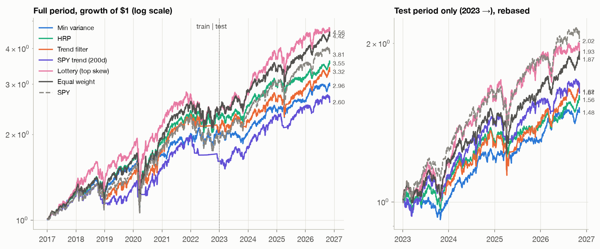
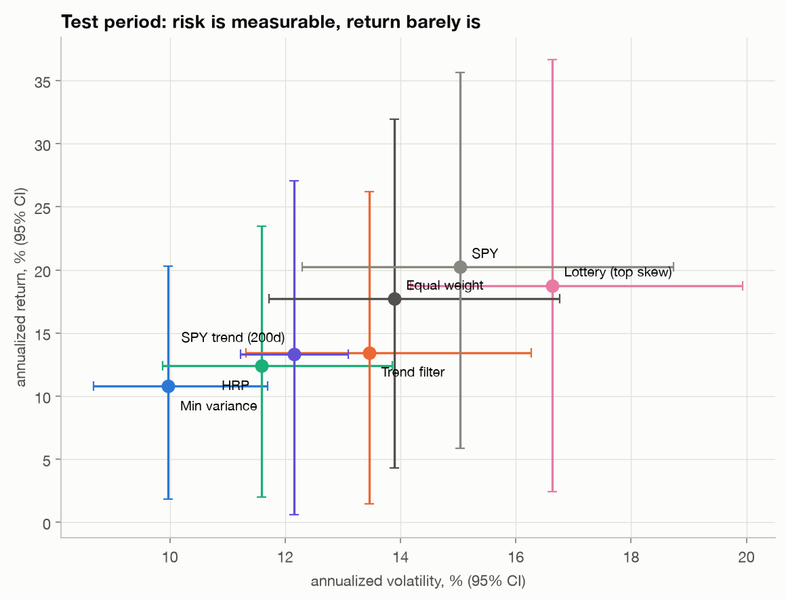
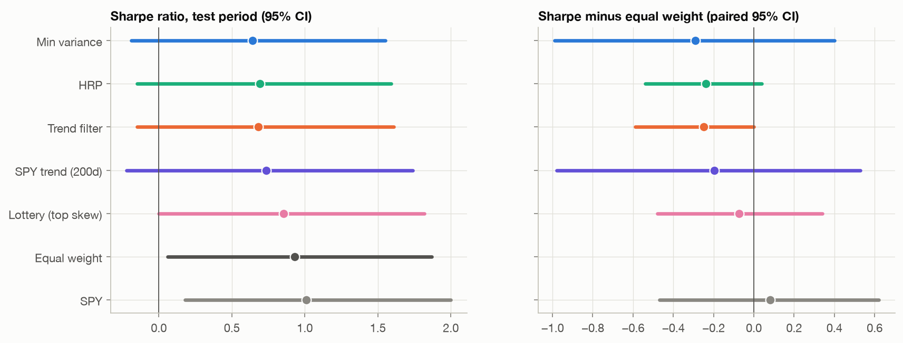
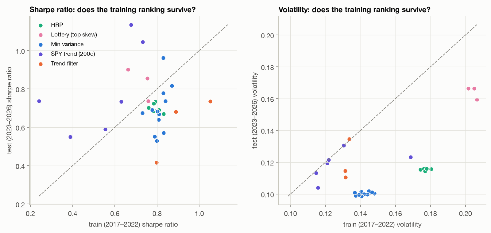
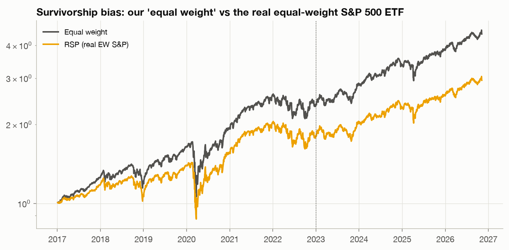

# Building portfolios from what we learned, and judging them honestly

*Part III of the S&P 500 correlation project. [Part I](what-the-pcs-mean.md)
read the principal components; [Part II](asymmetry.md) looked past
correlation at crashes and skew. Here we turn both into portfolios, test them
on data they've never seen, and ask what, if anything, counts as an edge.*

---

**TL;DR**

- Six approaches: **minimum variance** on an RMT-cleaned covariance (aiming at low
  vol), a **trend filter** on the equal-weight market and a **200-day SPY trend
  rule** (aiming at skew / crash protection), a **"lottery" portfolio** of the most
  positively skewed stocks (the naive way to buy skew), **Hierarchical Risk
  Parity**, and **the market** (SPY, plus equal weight).
- Trained on 2017–2022, tested once on 2023 to Nov 2026, with parameters fixed in advance.
- **What held up out of sample: lower risk.** Minimum variance had 10.0% volatility vs.
  13.9% for equal weight (paired 95% CI on the difference: −5.2 to −2.8 points), and
  a −10% max drawdown vs. −18%. That's a real, statistically solid property, but it
  isn't alpha: it loads 0.75 on the low-volatility ETF (t = 17).
- **What didn't: every return claim.** No strategy has a Sharpe ratio
  distinguishable from the benchmarks. With 3.8 years of data, the standard error of
  an annual Sharpe ratio is about 0.5, and at its observed edge the best "beat the
  market" candidate would need **73 years** of data to become significant.
- **The largest "alpha" in the whole study is a bug in the data.** Our
  equal-weight universe beats the real equal-weight S&P 500 ETF by **5.2% a year**
  in training (Fama-French-style alpha t = 5.4). That's survivorship bias: we
  used today's index members.
- The SPY trend rule **cut drawdowns but cost return**: it usually sold in time but
  bought back late. With a single market and only a handful of exit episodes, the
  trend rules **did not** deliver positive skew.

---

## 0. Ground rules (or: how not to be a LinkedIn quant)

A backtest is an experiment with one sample and a large number of hidden choices.
Most impressive equity curves come from four mistakes, so here's how we handle each:

| Mistake | What we did |
|---|---|
| **Look-ahead** | Weights on day $t$ use returns up to $t-1$, trade at the close of $t$, and earn from $t+1$. A unit test checks that no strategy ever sees the day it trades. |
| **Tuning on the test set** | Every parameter was fixed in advance from textbook defaults. 2017–2022 is training; 2023–Nov 2026 was run **once**. The full sensitivity grid (33 variants) is reported, not just the winner. |
| **Ignoring frictions** | Monthly rebalancing, weights drift between rebalances, 5 bps per side on all turnover (sensitivity: 0/10/25 bps), and cash earns T-bills (BIL ETF). |
| **No error bars** | Every number comes with a stationary block-bootstrap 95% interval (mean block 21 days). Differences between strategies are bootstrapped *paired* (same days), with Holm correction across strategies, deflated Sharpe ratios for the training grid, and Newey-West factor regressions. |

And one mistake we **couldn't** avoid, only measure: **survivorship bias.** More
on that in section 4; it turns out to be the biggest number in the article.

**Data.** 456 current S&P 500 members with full price history since 2015 (as in
Parts I–II); SPY, RSP (the actual equal-weight S&P 500 ETF) and BIL from Yahoo
Finance. The first two years of data are only used as estimation history, so
training runs Jan 2017 – Dec 2022 (6 years, including the late-2018 sell-off,
COVID, and the 2022 bear market). The test runs Jan 2023 – 6 Nov 2026 (3.85 years).

## 1. The strategies

### 1. Minimum variance: "low volatility, high return"

The honest version of "low vol, high return" starts with something uncomfortable:
**expected returns can't be estimated** with any useful precision from a few years
of data. (Part I's eigenportfolios had annual Sharpe standard errors near 0.5, and
the same is true here.) So the strategy doesn't try. It minimizes risk and lets
the **low-volatility anomaly**, the empirical tendency of low-risk stocks to earn
about as much as high-risk ones (Black, Jensen & Scholes 1972; Frazzini & Pedersen
2014), supply whatever return it can.

$$\min_w\ w^\top \Sigma w \quad \text{s.t.}\quad \textstyle\sum w_i = 1,\ 0 \le w_i \le 5\%$$

$\Sigma$ = (RMT-**clipped** correlation over 2 years, the README's method) × (EWMA
volatilities). With $N = 456$ stocks and $T = 504$ days, $q \approx 0.9$: the raw
correlation matrix is nearly singular, and clipping is what keeps the optimizer from
chasing noise. Rebalanced monthly. It typically holds ~125 names, but effectively
~25 (inverse Herfindahl).

### 2. Positive skew: trend filters (and a foil)

Part II found that the market's negative skew lives in the **market mode**: stocks
crash *together*. The textbook way to reshape the market's distribution is a **trend
rule**: be invested when the market is above its moving average, in cash
otherwise. Mechanically this buys after rises and sells after falls, which
approximately replicates a long straddle, i.e. it should be convex in the market and
positively skewed (Fung & Hsieh 2001; Moskowitz, Ooi & Pedersen 2012).

- **Trend filter:** the equal-weight universe when it's above its 210-day (~10-month)
  average at the monthly check (Faber 2007), else T-bills.
- **SPY trend (200d):** long **SPY** when its close is above its 200-day average,
  else BIL, **checked daily**. This one is special: it trades two real ETFs, so it's
  **completely free of survivorship bias**, and its natural benchmark is SPY itself.
- **Lottery (top skew), the foil:** equal-weight the 50 stocks with the highest
  trailing 1-year skewness. Part II predicts this *won't* produce a skewed portfolio,
  because portfolio skew is mostly **co**-skewness and diversification averages
  idiosyncratic skew away.

### 3. Another option: Hierarchical Risk Parity

HRP (López de Prado 2016) is the portfolio version of the README's spanning tree.
It clusters stocks with single linkage on $d = \sqrt{(1-\rho)/2}$ (single linkage
*is* the MST), orders them along the tree, then splits the list recursively, giving
each half weight inversely proportional to its variance. No matrix inversion, so the
noisy eigenvalues that wreck naive minimum variance never get amplified. It ends up
holding everything, with an effective N of about 250.

### 4. The market

**SPY** (cap-weighted, real, tradable) and **equal weight** across our 456 stocks,
the apples-to-apples benchmark, since it shares the strategies' universe and its
biases. **RSP**, the real equal-weight S&P 500 ETF, is there to measure those biases.

## 2. Training period, 2017–2022

| | return | vol | Sharpe | max DD | β (SPY) | monthly skew |
|---|---|---|---|---|---|---|
| Min variance | 12.3% | 14.4% | 0.81 | −32% | 0.59 | −0.21 |
| HRP | 14.7% | 17.6% | 0.81 | −34% | 0.85 | −0.49 |
| Trend filter | 12.7% | 13.4% | 0.89 | −21% | 0.43 | −0.15 |
| SPY trend (200d) | 8.3% | 12.2% | 0.63 | −19% | 0.38 | −0.40 |
| Lottery (top skew) | 15.4% | 20.5% | 0.75 | −35% | 0.97 | −0.37 |
| Equal weight (our universe) | 15.5% | 20.6% | 0.76 | −38% | 1.00 | −0.46 |
| SPY | 11.2% | 19.9% | 0.58 | −34% | 1.00 | −0.46 |
| RSP (real EW S&P 500) | 10.3% | 20.8% | 0.53 | −39% | 1.00 | −0.50 |

The mechanisms work as designed. Minimum variance and HRP cut volatility, and the
trend rules cut the maximum drawdown roughly in half. But note the gap between
the last three rows: **our "equal weight" made 15.5% a year while the real one made
10.3%.** Hold that thought (section 4).

**Deflated Sharpe ratio.** Across the 33 training variants, the highest Sharpe
ratio was 1.05. The deflated Sharpe ratio (Bailey & López de Prado 2014) asks how
likely each strategy's Sharpe ratio is to be genuinely above zero *after accounting
for how many variants were tried*. Every pre-registered strategy scores between
0.78 and 0.92, **none clears 0.95**. Even the training period doesn't give
convincing evidence of skill.

## 3. Test period, 2023 – Nov 2026 (run once)



| | return | vol | Sharpe [95% CI] | max DD | β | monthly skew |
|---|---|---|---|---|---|---|
| Min variance | 10.8% | **10.0%** | 0.64 [−0.19, 1.55] | **−10%** | 0.37 | −0.10 |
| HRP | 12.4% | 11.6% | 0.69 [−0.15, 1.59] | −14% | 0.58 | −0.25 |
| Trend filter | 13.5% | 13.5% | 0.68 [−0.15, 1.61] | −18% | 0.75 | −0.19 |
| SPY trend (200d) | 13.3% | 12.2% | 0.73 [−0.22, 1.74] | −12% | 0.65 | −0.43 |
| Lottery (top skew) | 18.8% | 16.6% | 0.86 [0.00, 1.82] | −21% | 0.99 | −0.15 |
| Equal weight (our universe) | 17.7% | 13.9% | 0.93 [0.06, 1.87] | −18% | 0.80 | −0.10 |
| **SPY** | **20.2%** | 15.0% | **1.01** [0.18, 2.00] | −19% | 1.00 | +0.16 |
| RSP (real EW S&P 500) | 13.8% | 14.0% | 0.68 [−0.17, 1.60] | −18% | 0.80 | −0.08 |

### What the error bars say



This is the most important chart in the article. **Horizontal bars (volatility) are
short; vertical bars (return) are enormous.** Minimum variance's volatility is pinned
to 8.7–11.7%; its annual return is somewhere between 1.9% and 20.3%. That isn't a
quirk of this sample. Volatility is estimated from squared deviations, so every day
carries information about it; the mean is estimated from the drift, and the drift is
tiny relative to the daily noise. The standard error of the mean scales with
$\sigma/\sqrt{T}$ *in years*, regardless of how often you sample.



Paired against equal weight (same days resampled together, which makes differences
far more precise than the individual intervals suggest):

| vs. equal weight | Δ Sharpe [95% CI] | Holm p | Δ vol [95% CI] | Holm p |
|---|---|---|---|---|
| Min variance | −0.29 [−0.99, 0.40] | 1.00 | **−3.9 pts [−5.2, −2.8]** | **<0.001** |
| HRP | −0.24 [−0.54, 0.04] | 0.36 | **−2.3 pts [−2.9, −1.7]** | **<0.001** |
| Trend filter | −0.25 [−0.59, 0.00] | 0.35 | −0.4 pts [−1.0, −0.0] | 0.07 |
| SPY trend (200d) | −0.20 [−0.98, 0.53] | 1.00 | −1.7 pts [−4.9, +0.5] | 0.25 |
| Lottery (top skew) | −0.07 [−0.48, 0.34] | 1.00 | **+2.7 pts [+1.9, +3.5]** | **<0.001** |

**Every Sharpe difference is consistent with zero; three of the volatility
differences are decisively not.** The SPY trend rule against its own benchmark
(SPY): Δ Sharpe −0.28, CI [−0.75, +0.19].

### Does the training ranking survive?



All 33 variants, training Sharpe vs. test Sharpe: rank correlation **−0.12**. The
best variant in training (trend filter with a 147-day average, Sharpe 1.05) finished
**11th of 33** in test. Picking the training winner bought nothing. Within the
SPY-trend family alone, the test Sharpe ranges from 0.55 to 1.14 depending only on the
moving-average length (50 to 250 days). That's the "garden of forking paths": had we
reported the 100-day rule, this article would claim the trend rule beat SPY.

Volatility behaves differently. Each family keeps its place: minimum variance lowest
in both periods, lottery highest. Within a family the variants are indistinguishable
(the clusters in the right panel), which is why the overall rank correlation is only 0.26.

## 4. The biggest number in the study is a data artifact



Our universe is the S&P 500 **as of November 2026**, restricted to stocks with prices
back to 2015. In January 2017 that's a portfolio nobody could have held: it
excludes every company that would later be dropped from the index or acquired, and
includes companies that only joined *because* they went on to do well.

| | our equal weight | RSP (real EW S&P 500) | gap |
|---|---|---|---|
| Training | 15.5% / yr | 10.3% / yr | **+5.2% / yr** |
| Test | 17.7% / yr | 13.8% / yr | **+3.9% / yr** |

(RSP also has fees, about 0.2%, and slightly different rebalancing, so part of the
gap isn't survivorship. Not 4–5% though.)

Now look at the factor regressions. Regress each strategy's daily excess returns on
five ETF factors (market, size, value, momentum, low vol) with Newey-West errors:

| Training 2017–2022 | alpha / yr | t |
|---|---|---|
| **Equal weight (our universe)** | **+5.6%** | **5.4** |
| HRP | +4.7% | 5.0 |
| Lottery | +5.5% | 2.4 |
| Trend filter | +7.9% | 1.9 |
| Min variance | +3.7% | 1.5 |
| SPY trend (200d), survivorship-free | +3.4% | 0.9 |

**The most "significant alpha" in this entire project, t = 5.4, belongs to doing
nothing (equal weight) in a biased universe.** HRP's t = 5 is the same thing, since HRP
holds everything. If you've seen a backtest of "S&P 500 stocks" with impressive
alpha, this is the first question to ask.

In the test period, **no strategy has significant alpha** (all |t| ≤ 0.5 except equal
weight, t = 1.7, which is again the bias, now smaller).

## 5. Strategy by strategy: is there an edge?

### Minimum variance: a real edge in *risk*, not in return

Out of sample it did exactly what it promised: 28% less volatility than equal weight,
half the drawdown, a beta of 0.37. Those numbers are precise, and they replicated
from training (vol 14.4% vs. 20.6% there). That's not luck: **second moments are
predictable.** Volatility clusters, correlations and betas move slowly, and the RMT
cleaning removes the part of the covariance estimate that isn't predictable.

But two caveats keep this from being "alpha":

1. **It's a known factor you can buy for 15 bps.** The factor regression loads 0.75
   on USMV − SPY (t = 17), with alpha 1.3% / yr, t = 0.5. The edge is the low-vol
   *exposure*, which an ETF already sells.
2. **"High return" wasn't delivered and couldn't be verified either way.** Its test
   return (10.8%) is below everything except cash. Under a low-vol anomaly you'd
   expect a *similar Sharpe ratio* to the market at lower risk, not a higher return.
   Its Sharpe was 0.64 vs. 1.01 for SPY, and the difference is far inside the noise.
   It's also the most cost-sensitive strategy (6.9× turnover per year): Sharpe 0.71 at
   0 bps, 0.36 at 25 bps.

**The nature of this edge:** it isn't an informational edge but a *structural
preference* edge. Investors who are leverage-constrained or benchmarked to an index
overpay for high-beta stocks; people who can hold low-beta stocks get the risk
reduction cheaply. It lasts because few can or want to exploit it, not because it's
hidden.

### HRP: a cheaper, gentler minimum variance

HRP cut volatility by 2.3 points (CI excludes zero) with **2.8×** turnover per year
instead of 6.9×, so it barely cares about costs (Sharpe 0.72 → 0.59 from 0 to 25 bps).
It's a robust *diversifier*, and its test volatility was close to its training
behavior. Its Sharpe ratio wasn't distinguishable from equal weight's.

### Trend rules: insurance with a premium, and no free skew

The SPY rule did what trend rules do. **Drawdowns shrank**: −19% vs. −34% for SPY in
training, −12% vs. −19% in test (its −24% worst drawdown on the full-period chart is
one 2022 drawdown that carried into early 2023). **Returns shrank too**: 13.3% vs.
20.2% in the test. The monthly trend filter cut drawdowns in training (−21% vs.
−38%) but **not in the test** (−18%, the same as equal weight): checking once a month
is too slow for a crash that starts and reverses within weeks.

Why the return drag? Every exit of the SPY 200-day rule, 2017–2026:

- **25 exits.** In **19 of them, SPY was higher when the rule bought back than when it
  sold.** It helped in the slow 2022 bear market (two long spells with SPY down
  2–4%) and hurt in the **V-shaped crashes**. In 2020 it was out from 9 March, so it
  avoided much of the COVID fall, but it stayed out through the rebound until 28 May,
  by which point SPY was 2.6% *above* where the rule had sold. In 2025 it was out from
  28 March, before the April tariff crash, and came back on 14 May, with SPY 3.5% higher.
- It got the exits right and the re-entries late. A 200-day average needs weeks to
  months of recovery before it turns, so a crash that reverses quickly costs you the
  rebound even when the rule sold in time, and the many short whipsaws in between
  add up.

And skew? **The SPY trend rule's monthly skew was *worse* than SPY's in the test
(−0.43 vs. +0.16)**, and roughly equal to it in training (−0.40 vs. −0.46). The
theoretical positive skew of trend following is a property of *many trend episodes
across many markets* (managed-futures funds trade 50–100 futures). One equity
index gives about 2–3 decisive episodes per decade; in 3.85 years the rule had 7
exits, most of them short whipsaws. **No statistic about skew can be learned from 7
events**, and Part II showed skew is made of a handful of days anyway.

**The nature of this edge:** to the extent trend following has one, it's
*behavioral and slow* (under-reaction, then herding), it pays off *across* markets and
decades, and on any single index it looks like insurance: you pay a premium in
whipsaws, and get paid in long, slow bear markets. Whether that's worth it is a
question about your utility, not about the backtest.

### Lottery: confirming Part II

Holding the 50 most positively skewed stocks produced a portfolio with **negative**
monthly skew (−0.37 in training, −0.15 in test), essentially the market's. Stock-level
skew diversifies away, exactly as the coskewness analysis predicted. What's left is
higher beta and size exposure (factor loadings 1.06 on the market and 0.22 on size)
and 2.7 points more volatility than equal weight. Its test Sharpe (0.86) was close to
equal weight's. Its active information ratio vs. equal weight was 0.19, at which point
the **minimum track record** to be 95% sure it's real is **73 years**.

### The market: hard to beat, and cheap

SPY had the best test Sharpe (1.01) and return (20.2%). The cap-weighted index was
dominated by the mega-cap names that led 2023–2026 (equal weighting the *real* index,
RSP, made 13.8%). None of our strategies beat it in a statistically meaningful way,
and none can be shown to underperform it either.

## 6. What "edge" means, given all this

1. **Risk is forecastable; returns mostly aren't.** The one result that replicated
   out of sample with tight error bars is volatility reduction. That's where
   quantitative portfolio construction earns its keep: in the second moment, the
   thing Part I and the README were about.
2. **A few years can't verify a return edge.** With a Sharpe standard error of
   about 0.5 per year of data, distinguishing a Sharpe of 0.6 from 0.9 takes decades.
   Anyone claiming a proven return edge from a 3–5 year backtest is either reporting
   noise or a very large edge, and very large edges in liquid US equities don't stay
   around.
3. **Most "alpha" is exposure or artifact.** Here the most significant alpha was
   survivorship bias; the most robust "edge" was the low-vol factor, which is
   available as an ETF.
4. **Real edges have a reason to exist.** The low-vol anomaly has one (leverage and
   benchmark constraints), and so does trend following (slow information diffusion).
   Each comes with a known cost: low-vol lags in strong bull markets; trend loses in V-shaped
   crashes. If you can't name the counterparty paying you and why, assume it's noise.
5. **Costs and degrees of freedom are part of the result.** At 25 bps, minimum
   variance loses half its Sharpe. Across 33 reasonable variants, the training ranking
   had zero predictive power for the test ranking.

**Next: [Part IV, "Markov chains and regimes: what the market's 'state' actually predicts"](markov.md)**
tests observable Markov chains and hidden Markov models, including the look-ahead
trap of smoothed regime probabilities and a 24-year walk-forward.

## Reproduce

```bash
uv run sp500-strategies    # ~6 min: training, 33-variant grid, test, bootstrap, figures
uv run pytest              # includes no-look-ahead and accounting tests for the engine
```

Code: `backtest.py` (engine, bootstrap, PSR/DSR/MinTRL, Newey-West),
`strategies.py`, `strat_article.py`. Every number above is in
`figures/strategies/numbers.json`.

*Caveats: survivorship-biased universe (except SPY, RSP and the SPY trend rule);
Yahoo Finance adjusted prices; costs are a flat bps assumption, not a market-impact
model; 3.85 years of out-of-sample data. Not investment advice.*

## References

- Black, Jensen & Scholes (1972). *The capital asset pricing model: some empirical tests.*
- Frazzini & Pedersen (2014). *Betting against beta.* JFE 111.
- López de Prado (2016). *Building diversified portfolios that outperform out of sample.* JPM 42.
- Faber (2007). *A quantitative approach to tactical asset allocation.* JWM 9.
- Fung & Hsieh (2001). *The risk in hedge fund strategies: theory and evidence from trend followers.* RFS 14.
- Moskowitz, Ooi & Pedersen (2012). *Time series momentum.* JFE 104.
- Lo (2002). *The statistics of Sharpe ratios.* FAJ 58.
- Bailey & López de Prado (2012, 2014). *The Sharpe ratio efficient frontier*; *The deflated Sharpe ratio.*
- Politis & Romano (1994). *The stationary bootstrap.* JASA 89.
- Ledoit & Wolf (2008). *Robust performance hypothesis testing with the Sharpe ratio.* JEF 15.
- Newey & West (1987). *A simple, positive semi-definite, heteroskedasticity and autocorrelation consistent covariance matrix.*
- Elton, Gruber & Blake (1996). *Survivorship bias and mutual fund performance.* RFS 9.
