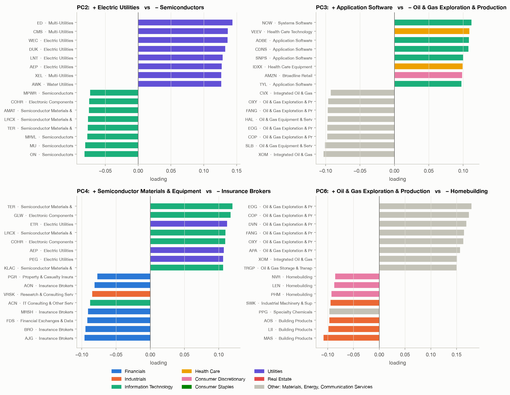
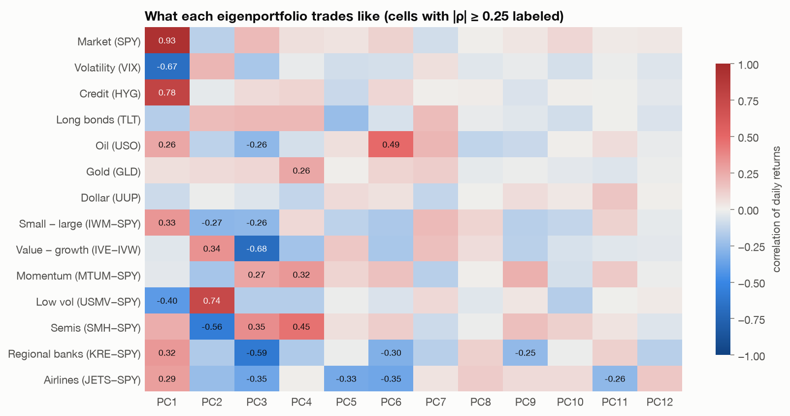
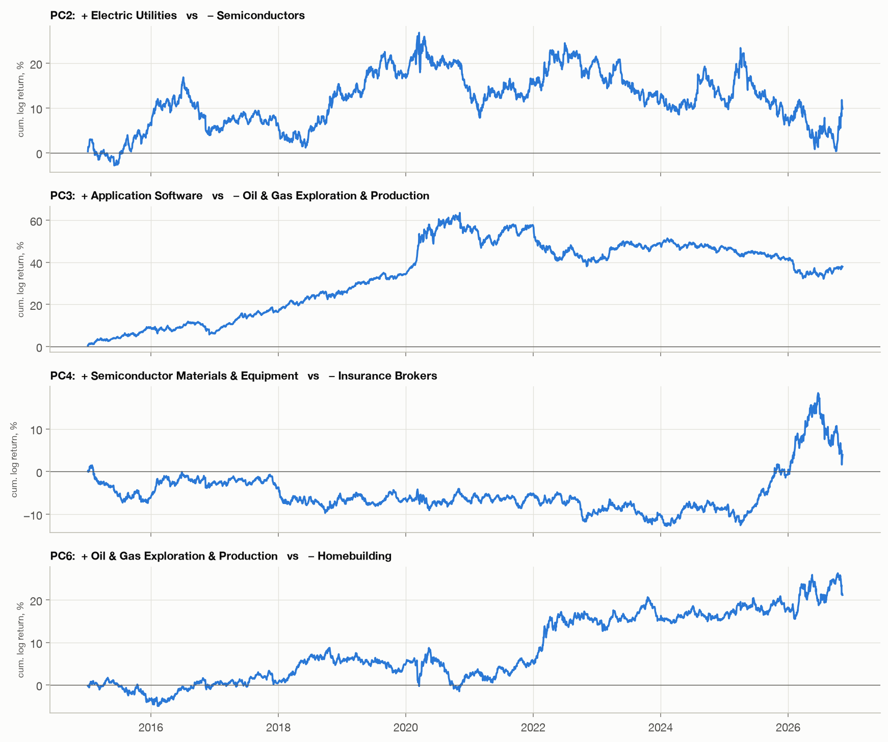
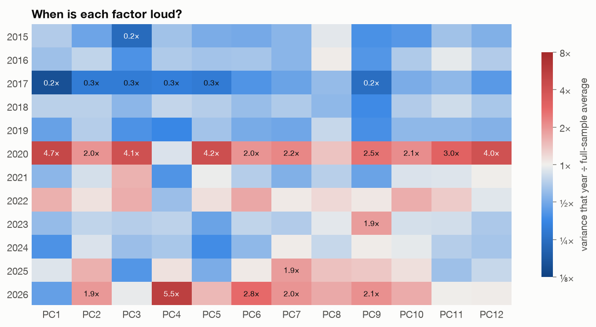
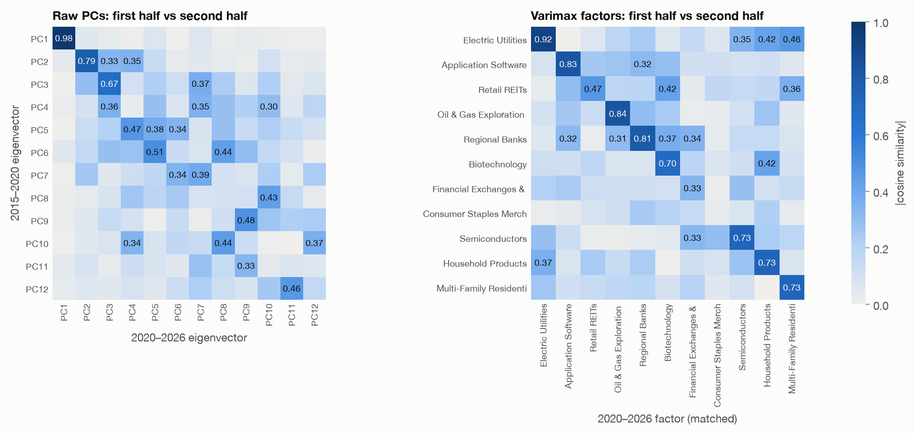
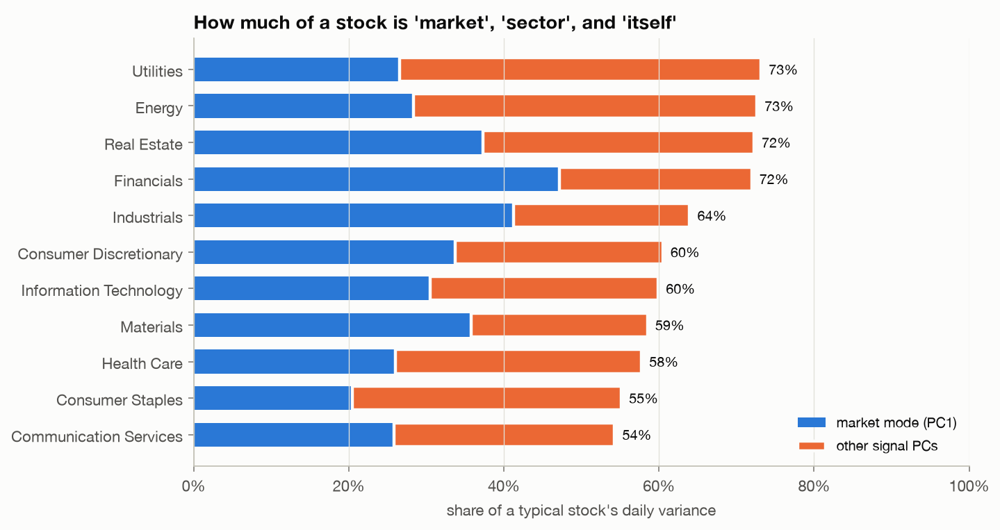

# What the principal components of the S&P 500 actually mean

*A hands-on guide to reading eigenvectors, using 12 years of daily returns
from 456 large US stocks.*

---

**TL;DR**

- Random matrix theory says **36 of the 456 eigenvalues** of the correlation
  matrix are signal. It tells you *how many*, but not *what they are*. This article
  is about the *what*.
- **PC1 is the market**, **PC2 is the low-volatility (defensive vs.
  cyclical) factor**, **PC3 is growth vs. value**, and **PC6 is oil**. We
  can tell because their portfolios correlate at 0.93, 0.74, −0.68 and 0.49 with
  ETFs that track those ideas. The algorithm was never told any of these.
- **PC4 barely existed for a decade and then dominated 2026.** It goes long
  chip equipment, optical components and power utilities and short insurance brokers and
  consulting/data firms.
- Past PC3, **individual eigenvectors are not stable objects**: they mix two
  unrelated sectors and change from one half of the sample to the other. The *subspace*
  they span is stable, though. A **varimax rotation** of that subspace recovers
  clean, persistent factors: utilities, software, semis, oil, banks, biotech,
  REITs, staples, travel, defense.
- For the median stock, **34% of daily variance is market, 30% is
  sector/style, and 36% is its own business.**

---

## 1. From "how many" to "what"

The [main README](../README.md) builds the 456 × 456 correlation matrix
$C$ of daily log returns (Jan 2015 – Nov 2026, $T = 2{,}980$ days) and
compares its eigenvalues with the Marchenko-Pastur law. Eigenvalues above
the noise edge $\lambda_+ = 1.28$ are signal: there are 36 of them, carrying
64% of the total variance.

That answers a statistical question. The economic question remains: what
*is* eigenvector 2? Or 7? An eigenvector is just a list of 456 numbers.
Turning it into a sentence like "utilities vs. chipmakers" takes some
method, and checking that the sentence is *true* takes some more.

## 2. How to read an eigenvector

Write the spectral decomposition $C = \sum_k \lambda_k v_k v_k^\top$. Three
facts make $v_k$ readable:

1. **Loadings are correlations (up to a scale).** The correlation between stock $i$ and
   the $k$-th component is $v_{ik}\sqrt{\lambda_k}$. A big positive $v_{ik}$
   means stock $i$ moves *with* that factor.
2. **Every eigenvector is a portfolio.** Hold stock $i$ with weight
   $\propto v_{ik}/\sigma_i$ (the $\sigma_i$ converts from standardized
   to dollar terms) and you get the *eigenportfolio*. Its daily returns are
   a time series you can correlate with anything.
3. **Signs are arbitrary, and orthogonality forces long-short.** $-v_k$ is
   as valid as $v_k$. Almost every pair of S&P 500 stocks is
   positively correlated (all but 0.06% of pairs; mean ρ = 0.33), so PC1 has
   all-positive loadings (the Perron-Frobenius intuition). Every later PC must be
   orthogonal to it, so it **must** have both positive and negative loadings.
   PCs 2+ are always "this group vs. that group", never "this group".

So we ask five questions of each component:

| Question | Tool | Code |
|---|---|---|
| Who loads on it? | Top ± loadings with GICS sub-industry | `interpret.top_loadings` |
| What does it trade like? | Correlate eigenportfolio returns with ETF proxies | `interpret.factor_correlations` |
| When is it active? | Variance of the factor per calendar year | `interpret.yearly_activity` |
| Is it the same object over time? | Eigenvector overlap, first vs. second half | `interpret.eigvec_overlap` |
| How much does it explain? | $R^2$ of each stock on the PCs | `interpret.r2_decomposition` |

The ETF proxies are long-short spreads against SPY wherever the idea is a
*style* (value − growth = IVE − IVW, low vol = USMV − SPY, …), so they don't
just measure the market again.

## 3. The first components, one by one





### PC1: the market (λ = 155, 34% of all variance)

Every loading is positive, between 0.016 and 0.066 (a perfectly uniform
vector would have 0.047 everywhere). The eigenportfolio correlates **0.93
with SPY**, 0.78 with high-yield credit and −0.67 with VIX moves. It's the
market, and also "risk-on vs. risk-off".

The *size* of a loading is informative too. The largest loadings belong to
asset managers, life insurers and industrial machinery (AMP, PRU, BLK, BRK-B,
ITW, PH): businesses that are, in effect, a slice of the whole economy. The
smallest belong to grocery, gold and household staples (KR, NEM, CLX, SJM,
DG). A PC1 loading is close to a correlation-based beta.

### PC2: defensive vs. cyclical (λ = 25.7)

Long electric and multi-utilities (ED, CMS, WEC, DUK), short semiconductors
(ON, MU, MRVL, LRCX, AMAT). Staples, REITs and health care sit on the
positive side; tech and industrials on the negative side.

The eigenportfolio correlates **0.74 with USMV − SPY**, the minimum-volatility
factor, and −0.56 with semis. Nobody told the PCA what "low volatility" means;
it is simply the second-strongest pattern in the data. When markets get
nervous, money rotates from high-beta chips into bond-like utilities, and that
rotation is PC2.

### PC3: growth vs. value (λ = 16.8)

Long application software (NOW, ADBE, CDNS, SNPS), health-care tech and
AMZN; short oil producers (XOM, COP, EOG, SLB) and banks. Its correlation
with **IVE − IVW (value − growth) is −0.68**, and −0.59 with regional banks
vs. the market.



The cumulative return of the eigenportfolio tells the decade's story: growth
beat value almost every month from 2015 to late 2020, then gave a chunk back
in 2022 when rates rose and energy rallied. (These curves use loadings estimated
on the full sample, so they *describe* what happened. They are not a strategy
you could have traded.)

### PC6: oil (λ = 7.2)

Long E&P (EOG, COP, DVN, FANG, OXY), short homebuilders and building
products (NVR, LEN, PHM, MAS, LII). It correlates **0.49 with crude oil**
(USO). A natural reading is that oil shocks feed inflation, inflation
pushes up mortgage rates, and housing suffers. The eigenvector found both
legs of that chain on its own.

### PC4: a 2026 story (λ = 9.8)

Long semiconductor equipment (TER, LRCX, KLAC), optical and electronic
components (GLW, COHR) **and** electric utilities (ETR, AEP, PEG). Short
insurance brokers (AJG, BRO, AON, MRSH), IT consulting (ACN) and
data/analytics firms (VRSK, FDS).



The activity heatmap shows PC4 was a quiet factor for a decade, then **5.5×
its normal variance in 2026**. Its cumulative return is flat-to-down from 2015
to 2025, swings up roughly 30 points from late 2025 to mid-2026, and partly
reverses. The long side looks like the physical build-out of AI data centers:
chip tools, optical interconnect, and the utilities that supply the power. The
short side is service businesses that markets may see as exposed to AI
disruption. That's an interpretation, not a proof: the data shows *which stocks
moved together and when*, and the story is ours.

PC4 also shows a general lesson. **Eigenvectors are dominated by whatever was
loud in the sample.** One very loud year can buy an entire principal component.

## 4. The deeper PCs are mixtures, and that's a warning

PCs 5–12 still pass the noise test, but read their loadings and something is off:

| PC | λ | + side | − side |
|---|---|---|---|
| 5 | 7.8 | heavy machinery, big pharma | retail & health-care REITs, cruise lines |
| 7 | 5.6 | homebuilders, oil producers | big banks, brokers |
| 8 | 4.6 | biotech & pharma | industrial distributors, auto parts retail |
| 9 | 4.5 | managed care, food distributors | office REITs, asset managers |
| 10 | 4.0 | packaged food, big-box retail | life-science tools, electrical equipment |
| 11 | 3.2 | apartment & self-storage REITs | cruise lines, airlines, casinos |
| 12 | 3.0 | defense contractors | regional banks |

PC11 is clearly the COVID "stay home vs. go out" trade (it correlates −0.26
with airlines, and 2020 was its loudest year at 3×). But why are oil
producers and homebuilders on the *same* side of PC7, when PC6 put them on
opposite sides?

Because **eigenvalues 5 through 12 are crowded together** (7.8, 7.2, 5.6, 4.6,
4.5, 4.0, …). When two eigenvalues are close, any rotation of their
two eigenvectors is *almost* as good a fit as the eigenvectors themselves.
Sampling noise then decides which rotation PCA reports. Its only rules are
"orthogonal" and "sorted by variance", and neither is an economic principle.
The result is a set of sector factors blended into each other.

You can see this directly by splitting the sample in half (Jan 2015 – Dec 2020
vs. Dec 2020 – Nov 2026) and comparing eigenvectors:



**Left panel.** PC1 is nearly identical in both halves (overlap 0.98), PC2 is
strong (0.79), PC3 decent (0.67). Beyond that the diagonal fades: PC4's
overlap with the other half's PC4 is **0.03**, which is as good as random (a random
unit vector scores about 0.04). Even pairing each PC with its best match in the
other half, the median overlap for PCs 2–12 is only 0.46.

But the *subspace* is stable. The top 10 eigenvectors of one half capture
**64% of the top-10 subspace** of the other, when chance would give 10/456 ≈ 2%.
**The space is real; the axes inside it aren't.**

## 5. The fix: rotate (varimax)

If the subspace is meaningful but the axes are arbitrary, pick better axes.
**Varimax** (Kaiser, 1958) searches over orthogonal rotations $R$ of the
loading matrix $L = [v_2\sqrt{\lambda_2}, \dots, v_{12}\sqrt{\lambda_{12}}]$
for the one that maximizes

$$\sum_{k} \operatorname{Var}_i\!\left[(LR)_{ik}^2\right],$$

i.e. it wants each factor to load *heavily on a few stocks and near zero on
the rest*. It's the same span and the same total variance (92.3 units), just
different axes. We leave PC1 alone, since the market is already clean. The result:

| Rotated factor | Variance | Top loadings |
|---|---|---|
| Electric utilities | 19.1 | CMS, ED, WEC, AEP, LNT, DUK |
| Semiconductor equipment | 12.4 | LRCX, AMAT, TER, MRVL, KLAC, MU |
| Oil & gas E&P | 10.2 | EOG, DVN, COP, FANG, OXY, APA |
| Application software | 10.1 | NOW, ADBE, CRM, WDAY, INTU, TYL |
| Regional & large banks | 7.3 | HBAN, BAC, MTB, KEY, TFC, USB |
| Packaged food & household | 6.2 | GIS, KR, CLX, SJM, CHD, HRL |
| Pharma & biotech | 6.1 | TMO, AMGN, REGN, BDX, MRK, ABBV |
| Travel | 5.6 | NCLH, CCL, RCL, UAL, DAL, EXPE |
| Apartment REITs | 5.5 | UDR, ESS, VMRK, CPT, DOC, MAA |
| Insurers, exchanges & managed care | 5.3 | HIG, CME, CBOE, TRV, ELV, UNH |
| Defense | 4.5 | LMT, NOC, LHX, GD, HII, RTX |

Every factor is now one recognizable industry. They're also **far more stable**
(right panel above): 8 of the 11 rotated factors match their other-half
counterpart with overlap ≥ 0.70, and the median is 0.73, against 0.46 for
best-matched raw PCs. PCA's ordering by variance is the right tool for finding the
subspace; a sparsity-seeking rotation is the right tool for naming what's
inside it.

## 6. How much of a stock is market, sector, and itself?

Since the loading $v_{ik}\sqrt{\lambda_k}$ is a correlation, the $R^2$ of
stock $i$ on any set of PCs is $\sum_k \lambda_k v_{ik}^2$.



- The **median stock** is 34% market, 64% explained by all 36 signal
  components, and **36% idiosyncratic**: news about that one company.
- **Financials** are the most "market" sector (47% from PC1 alone); the
  most market-like individual names are AMP, PRU, BLK, PFG and BRK-B.
- **Utilities and Energy** have *low* market exposure (≈ 27%) but the
  *highest* total explained variance (73%). They move as a block, but the block is
  only loosely tied to the market. That's exactly why they show up as the
  cleanest MST branches and the strongest rotated factors.
- **Consumer Staples and Communication Services** are the least explained
  (≈ 55%): more company-specific stories.
- The most idiosyncratic large stocks are PCG (a utility whose history is
  dominated by its own wildfire liabilities), SMCI, DPZ and DVA, with only
  24–35% of variance explained by all 36 factors.

One caveat: these are in-sample $R^2$ values, and part of each "signal"
eigenvalue is itself noise, so they're mildly optimistic.

## 7. Reading the activity heatmap

Going back to the activity heatmap from section 3:

- **2020** lit up nearly every factor (PC1 at 4.7×, PC3 at 4.1×, PC5 at 4.2×,
  PC12 at 4×). In a crisis everything's variance explodes, sector factors
  included.
- **2017** was the quietest year for nearly every factor (PC1 at 0.2×). It
  was a famously calm year for markets.
- **2026** is unusual: the market factor is quiet (0.5×) while PC4 (5.5×),
  PC6 (2.8×) and PC2 (1.9×) are loud. The action is in rotations *between*
  groups of stocks, not in the market as a whole.

## 8. Checklist for interpreting PCs

1. **Check the noise edge first.** Below $\lambda_+$, there's nothing to interpret.
2. **Read both tails.** PCs past the first are long-short; a PC is a
   *contrast*, and naming only one side gets it wrong.
3. **Validate with something external.** Loadings are a guess at a story; a
   correlation with an independent proxy (ETF, macro series) is evidence.
4. **Check when it's active.** A component can be one year in disguise.
5. **Check stability across subsamples.** If the eigenvector doesn't survive
   a split, interpret the subspace, not the axis.
6. **Rotate if you want names.** Varimax (or any sparse rotation) of the
   signal subspace gives factors you can name, which PCA's ordering by
   variance does not.

**Next: [Part II, "Do stocks fall together? Leaving the quadratic world"](asymmetry.md)**
looks at what correlation can't see: down- vs. up-market structure,
semicovariance, tail dependence, and the coskewness tensor.

## Reproduce

```bash
uv run sp500-corr       # downloads data, base analysis (README figures)
uv run sp500-article    # everything in this article -> figures/article/
```

`figures/article/top_loadings.md` lists the top ±8 loadings for all 12 PCs,
and `numbers.json` holds every number quoted above.

*Caveats as in the README: current index members only (survivorship bias),
Yahoo Finance data, in-sample estimates. Interpretations like "AI build-out" are
hypotheses suggested by the loadings, not something the statistics can prove.*
